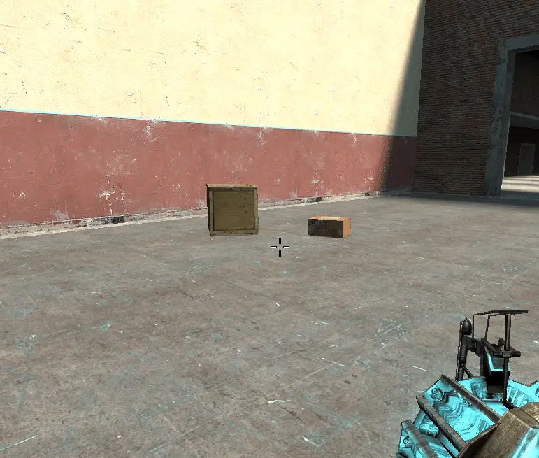

# 3D

Three-dimensional drawing functions.

## Mantle.func.draw_ent_text

Draws text above an entity.



```js
hook.Add('HUDPaint', 'Test', function()
    for _, ent in ipairs(ents.FindByClass('prop_physics')) do
        if !IsValid(ent) then continue end

        Mantle.func.draw_ent_text(ent, ent:GetModel():GetFileFromFilename(), 60)
    end
end)
```

| Argument | Type     | Description                                  |
| -------- | -------- | -------------------------------------------- |
| `ent`    | `object` | The entity to draw the text above            |
| `text`   | `string` | The text to display                          |
| `posY`   | `int`    | Vertical offset from the entity's center     |
