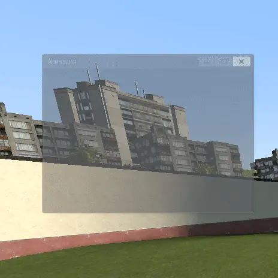
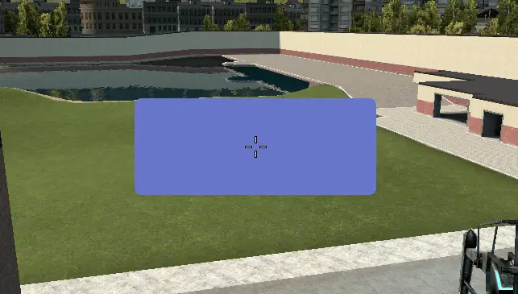
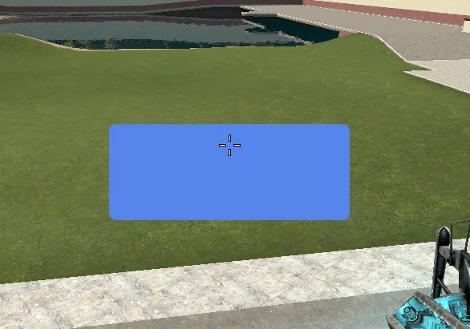
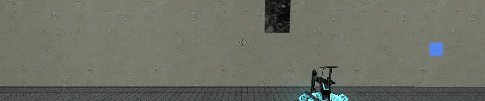

# Layout and animation

## Responsive sizes

Sizes are specified relative to 1920x1080 and scaled to the monitor.

```js
local width = Mantle.func.w(400)
local height = Mantle.func.h(300)
```

## Panel appearance animation



```js
local frame = vgui.Create('DFrame')
frame:SetTitle('Animation')
frame:SetPos(200, 100)

Mantle.func.animate_appearance(frame, 400, 300, 5, 6, function()
    print('Animation finished')
end, 0.8)
```

| Argument               | Type     | Description                                               |
| ---------------------- | -------- | --------------------------------------------------------- |
| `panel`                | `object` | Panel                                                     |
| `target_w`, `target_h` | `int`    | Target panel size                                         |
| `duration`             | `int`    | Growth duration in seconds. For example `5`               |
| `alpha_dur`            | `int`    | Fade-in duration. For example `6`                         |
| `callback`             | `func`   | Called when the animation finishes. Optional              |
| `scale_factor`         | `int`    | Starting size as a fraction of the target. Default `0.8`  |

## Smooth color transition

`LerpColor(speed, from, to, dt)` moves the color exponentially closer to the target every frame. `speed` is the approach rate: the higher the value, the faster it moves (for example `8`). The speed does not depend on FPS.

`dt` is optional and defaults to `FrameTime()`. The function returns a new `Color`, so you have to assign the result.



```js
local col = Mantle.color.theme

hook.Add('HUDPaint', 'Test', function()
    col = Mantle.func.LerpColor(0.1, col, Color(182, 65, 65))

    local w, h = 300, 120
    local x, y = (ScrW() - w) / 2, (ScrH() - h) / 2

    RNDX.Rect(x, y, w, h)
        :Rad(16)
        :Color(col)
    :Draw()
end)
```

## Exponential approach

`approachExp(current, target, speed, dt)` smoothly moves a value toward its target. It is a good fit for inertia-like motion: the square glides downward.



```js
local offset = 0
local target = 200

hook.Add('HUDPaint', 'Test', function()
    offset = Mantle.func.approachExp(offset, target, 10, FrameTime())

    local w, h = 300, 120
    local x, y = (ScrW() - w) / 2, (ScrH() - h) / 2

    RNDX.Rect(x, y + offset, w, h)
        :Rad(16)
        :Color(Mantle.color.theme)
    :Draw()
end)
```

## Easing functions

`t` is the progress from 0 to 1. The square moves across the screen with acceleration and deceleration.



```js
local duration = 2

hook.Add('HUDPaint', 'Test', function()
    local elapsed = (CurTime() % duration) / duration

    -- Fast start, smooth finish
    local t = Mantle.func.easeOutCubic(elapsed)

    -- Smooth start, fast finish
    -- local t = Mantle.func.easeInOutCubic(elapsed)

    local size = 50
    local x = ScrW() * 0.1 + t * (ScrW() * 0.8 - size)

    RNDX.Rect(x, ScrH() * 0.5, size, size)
        :Color(Mantle.color.theme)
    :Draw()
end)
```

Two functions are available: `easeOutCubic` (fast start, smooth finish) and `easeInOutCubic` (smooth start and finish). Uncomment the line you need.

## Keeping a panel on screen

Prevents a panel from going off the edge of the screen.

```js
local menu = vgui.Create('DPanel')
menu:SetSize(200, 100)
menu:SetPos(ScrW() - 50, ScrH() - 50)

Mantle.func.ClampMenuPosition(menu)
```
