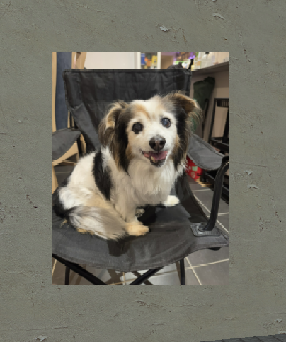

# URL material

Downloads an image from a link and returns a material.



```js
http.DownloadMaterial('https://i.imgur.com/eEnGbcp.jpeg', 'dog.png', function(mat)
    hook.Add('HUDPaint', 'Test', function()
        surface.SetDrawColor(255, 255, 255)
        surface.SetMaterial(mat)
        surface.DrawTexturedRect(100, 100, 250, 330)
    end)
end)
```

| Argument      | Type     | Description                                                         |
| ------------- | -------- | ------------------------------------------------------------------- |
| `url`         | `string` | Link to the image                                                   |
| `path`        | `string` | File path relative to `garrysmod/data` (for example `data/dog.png`) |
| `callback`    | `func`   | Called with the ready material                                      |
| `retry_count` | `int`    | Number of retries on failure. Optional                              |
