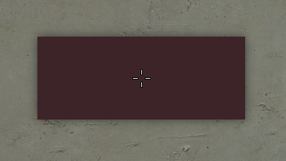

# Legacy Shadows

Shadow rendering via Render Targets. This is a legacy system; for new projects use the built-in RNDX shadow via `:Shadow()`.

## Example



```js
local w, h = 300, 120
local x, y = (ScrW() - w) / 2, (ScrH() - h) / 2

hook.Add('HUDPaint', 'Test', function()
    BShadows.BeginShadow()
        RNDX.Rect(x, y, w, h)
            :Color(Mantle.color.panel[1])
        :Draw()
    BShadows.EndShadow(1, 2, 2, 255, 0, 0)
end)
```

## EndShadow parameters

| Argument      | Type     | Description                     |
| ------------- | -------- | ------------------------------- |
| `intensity`   | `number` | Shadow intensity                |
| `spread`      | `number` | Spread size                     |
| `blur`        | `number` | Blur                            |
| `opacity`     | `number` | Opacity                         |
| `direction`   | `number` | Direction                       |
| `distance`    | `number` | Distance from the object        |
| `shadow_only` | `bool`   | Draw the shadow only. Optional  |

## Shadow of an existing texture

Draws a shadow around an already rendered texture (for example, a panel render target) without `BeginShadow`/`EndShadow`.

```js
BShadows.DrawShadowTexture(texture, 2, 4, 6, 200, 0, 3)
```

| Argument      | Type      | Description                           |
| ------------- | --------- | ------------------------------------- |
| `texture`     | `texture` | Source texture                        |
| `intensity`   | `number`  | Shadow intensity                      |
| `spread`      | `number`  | Spread size                           |
| `blur`        | `number`  | Blur                                  |
| `opacity`     | `number`  | Opacity. Default `255`                |
| `direction`   | `number`  | Direction. Default `0`                |
| `distance`    | `number`  | Distance from the object. Default `0` |
| `shadow_only` | `bool`    | Do not draw the source texture        |
