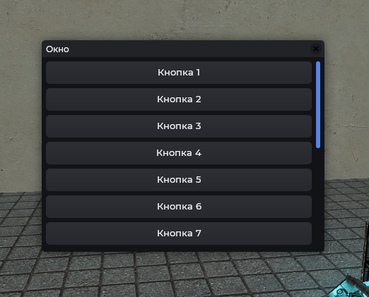
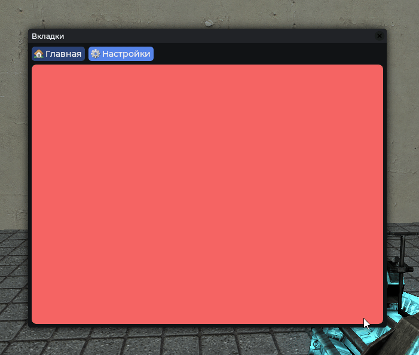

# Legacy UI

Styling helpers for standard VGUI elements (`DFrame`, `DButton`, etc.). They exist to keep old scripts working. For new projects, use the `Mantle` elements instead.

## Differences from the new elements

| Legacy                 | New element                     |
| ---------------------- | ------------------------------- |
| `Mantle.ui.frame`      | `vgui.Create('MantleFrame')`    |
| `Mantle.ui.btn`        | `vgui.Create('MantleBtn')`      |
| `Mantle.ui.slidebox`   | `vgui.Create('MantleSlideBox')` |
| `Mantle.ui.checkbox`   | `vgui.Create('MantleCheckBox')` |
| `Mantle.ui.desc_entry` | `vgui.Create('MantleEntry')`    |
| `Mantle.ui.panel_tabs` | `vgui.Create('MantleTabs')`     |

## Example



```js
local frame = vgui.Create('DFrame')
Mantle.ui.frame(frame, 'Window', 600, 500, true, true)
frame:Center()
frame:MakePopup()

local scroll = vgui.Create('DScrollPanel', frame)
Mantle.ui.sp(scroll)
scroll:Dock(FILL)

for k = 1, 15 do
    local btn = vgui.Create('DButton', scroll)
    Mantle.ui.btn(btn)
    btn:Dock(TOP)
    btn:DockMargin(0, 0, 0, 6)
    btn:SetText('Button ' .. k)
end
```

## Functions

### Mantle.ui.frame

Styling for `DFrame`.

```js
local frame = vgui.Create('DFrame')
Mantle.ui.frame(frame, 'Window', 600, 500, true, true)
frame:Center()
frame:MakePopup()
```

### Mantle.ui.sp

Styling for `DScrollPanel`.

```js
local frame = vgui.Create('DFrame')
Mantle.ui.frame(frame, 'List', 600, 500, true, true)
frame:Center()
frame:MakePopup()

local scroll = vgui.Create('DScrollPanel', frame)
Mantle.ui.sp(scroll)
scroll:Dock(FILL)

for k = 1, 15 do
    local btn = vgui.Create('DButton', scroll)
    Mantle.ui.btn(btn)
    btn:Dock(TOP)
    btn:DockMargin(0, 0, 0, 6)
    btn:SetText('Button ' .. k)
end
```

### Mantle.ui.btn

Styling for `DButton`.

```js
local frame = vgui.Create('DFrame')
Mantle.ui.frame(frame, 'Buttons', 600, 500, true, true)
frame:Center()
frame:MakePopup()

local btn = vgui.Create('DButton', frame)
Mantle.ui.btn(btn, Material('icon16/delete.png'), 16)
btn:SetPos(20, 40)
btn:SetSize(180, 40)
btn:SetText('Delete')
```

### Mantle.ui.slidebox

A slider bound to a ConVar.

```js
local frame = vgui.Create('DFrame')
Mantle.ui.frame(frame, 'Interface toggle', 600, 500, true, true)
frame:Center()
frame:MakePopup()

local slider = Mantle.ui.slidebox(frame, 'Value', 0, 5, 'cl_drawhud', 0)
slider:SetPos(20, 40)
slider:SetWide(400)
```

### Mantle.ui.desc_entry

An input field with a title. Returns the entry and its background panel.

```js
local frame = vgui.Create('DFrame')
Mantle.ui.frame(frame, 'Input', 600, 500, true, true)
frame:Center()
frame:MakePopup()

local entry, bg = Mantle.ui.desc_entry(frame, 'Nickname', 'Enter a nickname...')
bg:SetPos(20, 40)
bg:SetWide(400)
```

### Mantle.ui.checkbox

A toggle bound to a ConVar. Returns the panel and the button.

```js
local frame = vgui.Create('DFrame')
Mantle.ui.frame(frame, 'Settings', 600, 500, true, true)
frame:Center()
frame:MakePopup()

local panel, option = Mantle.ui.checkbox(frame, 'Show HUD', 'cl_drawhud')
panel:SetPos(20, 40)
```

### Mantle.ui.panel_tabs

A tab panel. Configure it with `:AddTab(title, panel, icon, col, col_hov)` and `:ActiveTab(title)`.



```js
local frame = vgui.Create('DFrame')
Mantle.ui.frame(frame, 'Tabs', 600, 500, true, true)
frame:Center()
frame:MakePopup()

local tabs = Mantle.ui.panel_tabs(frame)
tabs:Dock(FILL)
tabs:DockMargin(20, 30, 20, 20)

local page1 = vgui.Create('DPanel')
tabs:AddTab('Home', page1, 'icon16/house.png')

local page2 = vgui.Create('DPanel')
tabs:AddTab('Settings', page2, 'icon16/cog.png')

tabs:ActiveTab('Settings')
```
