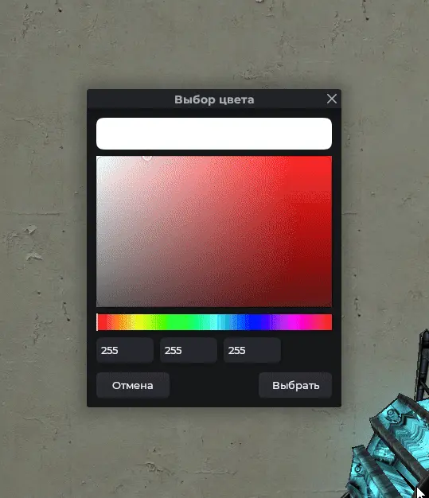
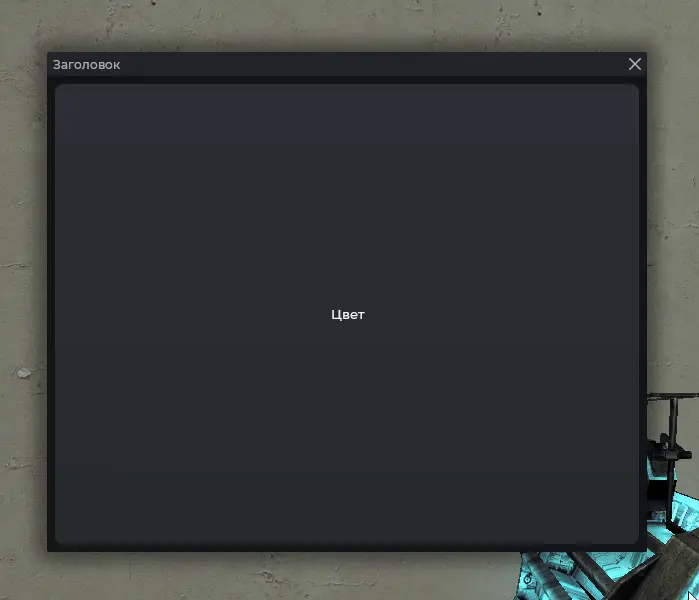

# Color picker

A color picker with a palette and sliders. Open it with `Mantle.ui.color_picker(callback, defaultColor)`; the result arrives in `callback`.

## Example



```js
Mantle.ui.color_picker(function(color)
    print(color.r, color.g, color.b)
end)
```

## With a default color

```js
Mantle.ui.color_picker(function(color)
    print('New color:', color.r, color.g, color.b)
end, Color(182, 65, 65))
```

## Applying a color to an element



```js
local frame = vgui.Create('MantleFrame')
frame:SetSize(600, 500)
frame:Center()
frame:MakePopup()

local btn = vgui.Create('MantleBtn', frame)
btn:Dock(FILL)
btn:SetTxt('Color')

btn.DoClick = function()
    Mantle.ui.color_picker(function(color)
        btn:SetColor(color)
    end, btn:GetColor())
end
```

## Arguments

| Argument       | Type       | Description                           |
| -------------- | ---------- | ------------------------------------- |
| `callback`     | `function` | Called with the selected `Color`      |
| `defaultColor` | `Color`    | Initial color in the window. Optional |
