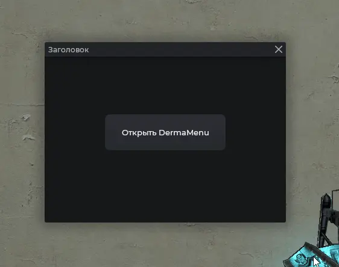
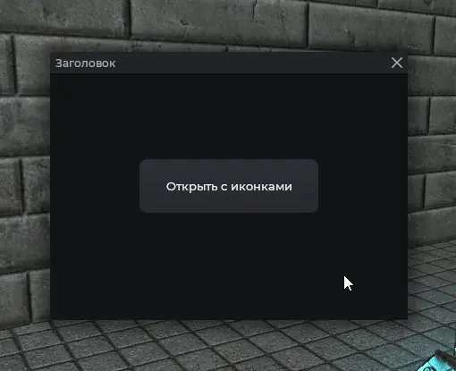
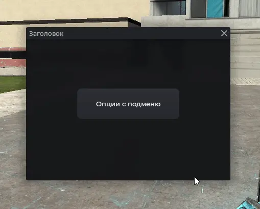

# Context menu

A context menu that opens at the cursor.

## Example



```js
local frame = vgui.Create('MantleFrame')
frame:SetSize(400, 300)
frame:Center()
frame:MakePopup()

local btn = vgui.Create('MantleBtn', frame)
btn:SetSize(200, 60)
btn:Center()
btn:SetTxt('Open DermaMenu')

btn.DoClick = function()
    local dm = Mantle.ui.derma_menu()
    dm:AddOption('Pick an apple', function()
        print('Apple')
    end)
    dm:AddOption('Pick a banana', function()
        print('Banana')
    end)
end
```

## Items with icons



```js
local frame = vgui.Create('MantleFrame')
frame:SetSize(400, 300)
frame:Center()
frame:MakePopup()

local btn = vgui.Create('MantleBtn', frame)
btn:SetSize(200, 60)
btn:Center()
btn:SetTxt('Open with icons')

btn.DoClick = function()
    local dm = Mantle.ui.derma_menu()
    dm:AddOption('Save', function() end, 'icon16/disk.png')
    dm:AddOption('Delete', function() end, 'icon16/delete.png')
end
```

## Submenus



```js
local frame = vgui.Create('MantleFrame')
frame:SetSize(400, 300)
frame:Center()
frame:MakePopup()

local btn = vgui.Create('MantleBtn', frame)
btn:SetSize(200, 60)
btn:Center()
btn:SetTxt('Options with submenus')

btn.DoClick = function()
    local menu = Mantle.ui.derma_menu()

    local sub = menu:AddOption('Actions', function() end)
    local submenu = sub:AddSubMenu()
    submenu:AddOption('Rename', function() end)
    submenu:AddOption('Duplicate', function() end)
end
```

## Methods

| Method                                                                         | Description                                                         |
| ------------------------------------------------------------------------------ | ------------------------------------------------------------------- |
| `:AddOption(string text, function func, string\|material icon, table optData)` | Add an item. `optData` holds extra fields. Returns the created item |
| `:AddSpacer()`                                                                 | Separator line                                                      |
| `:SetAnchor(panel)`                                                            | Open the menu next to a specific panel                              |
| `:OpenAt(number x, number y)`                                                  | Open the menu at the given coordinates                              |
| `:UpdateSize()`                                                                | Recalculate the size for the current items                          |
| `:CloseMenu()`                                                                 | Close the menu                                                      |

## Menu item

The object returned by `AddOption`:

| Method                   | Description       |
| ------------------------ | ----------------- |
| `option:AddSubMenu()`    | Create a submenu  |
| `option:OpenSubMenu()`   | Open the submenu  |
| `option:CloseSubMenu()`  | Close the submenu |

## Notes

- If the menu would be too tall, its height is capped and the items become scrollable.
- If a submenu does not fit on the right, it opens to the left; if it does not fit below, it opens upward.
