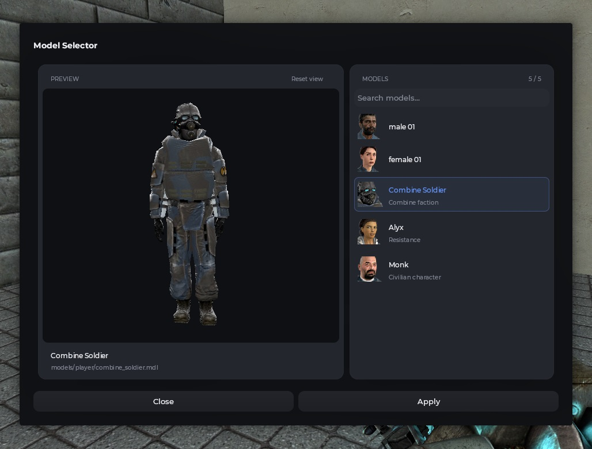

# Model selector

A window with a model catalog and an interactive preview.

## Example



```js
Mantle.ui.model_selector({
    'models/player/group01/male_01.mdl',
    'models/player/group01/female_01.mdl',
    {
        model = 'models/player/combine_soldier.mdl',
        name = 'Combine Soldier',
        description = 'Combine faction'
    },
    {
        model = 'models/player/alyx.mdl',
        name = 'Alyx',
        description = 'Resistance'
    },
    {
        model = 'models/player/monk.mdl',
        name = 'Monk',
        description = 'Civilian character'
    }
}, function(model, data, index)
    local name = istable(data) and data.name or model

    chat.AddText('Selected model: ', Mantle.color.theme, name, color_white, ' (' .. model .. ')')
end)
```

## Model format

The list accepts two ways of passing models.

**A plain string with the model path:**

```js
'models/player/group01/male_01.mdl'
```

In this case the display name is generated automatically from the model path.

**A table with extra information:**

```js
{
    model = 'models/player/combine_soldier.mdl',
    name = 'Combine Soldier',
    description = 'Combine faction'
}
```

Fields:

| Field         | Type     | Description               |
| ------------- | -------- | ------------------------- |
| `model`       | `string` | Path to the `.mdl` file   |
| `name`        | `string` | Display name of the model |
| `description` | `string` | Extra model description   |

## Preview

The window offers interactive viewing of the selected model:

- Drag with the mouse to rotate the model.
- Use the mouse wheel to zoom in and out.
- The reset button returns the camera to its starting position.
- Automatic rotation can be turned on or off.

## Arguments

| Argument   | Type       | Description                                       |
| ---------- | ---------- | ------------------------------------------------- |
| `models`   | `table`    | List of models to display                         |
| `onSelect` | `function` | Callback invoked after the selection is confirmed |

The `onSelect` callback receives three arguments:

| Argument | Type           | Description                            |
| -------- | -------------- | -------------------------------------- |
| `model`  | `string`       | Path of the selected model             |
| `data`   | `string/table` | The original entry from the model list |
| `index`  | `number`       | Index of the selected model            |

## Embeddable panel

If you need a catalog inside your own interface rather than a separate window, use the [`MantleModelSelector`](../ui/model-selector.md) panel.
