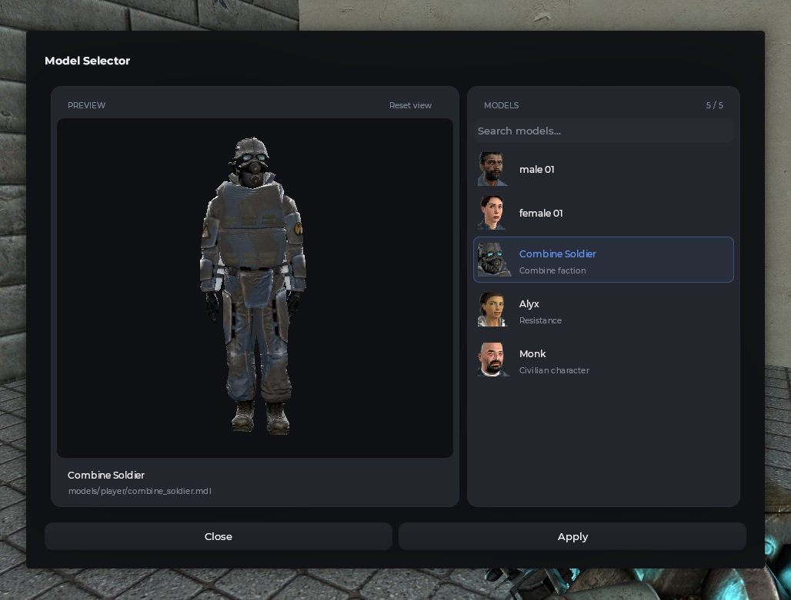

# Выбор модели

Окно с каталогом моделей и интерактивным предпросмотром.

## Пример



```js
Mantle.ui.model_selector({
    'models/player/group01/male_01.mdl',
    'models/player/group01/female_01.mdl',
    {
        model = 'models/player/combine_soldier.mdl',
        name = 'Combine Soldier',
        description = 'Combine faction'
    },
    {
        model = 'models/player/alyx.mdl',
        name = 'Alyx',
        description = 'Resistance'
    },
    {
        model = 'models/player/monk.mdl',
        name = 'Monk',
        description = 'Civilian character'
    }
}, function(model, data, index)
    local name = istable(data) and data.name or model

    chat.AddText('Selected model: ', Mantle.color.theme, name, color_white, ' (' .. model .. ')')
end)
```

## Формат моделей

Список поддерживает два варианта передачи моделей.

**Обычная строка с путём к модели:**

```js
'models/player/group01/male_01.mdl'
```

В этом случае название формируется автоматически на основе пути модели.

**Таблица с дополнительной информацией:**

```js
{
    model = 'models/player/combine_soldier.mdl',
    name = 'Combine Soldier',
    description = 'Combine faction'
}
```

Поля:

| Поле | Тип | Описание |
| --- | --- | --- |
| `model` | `string` | Путь к `.mdl` файлу |
| `name` | `string` | Отображаемое название модели |
| `description` | `string` | Дополнительное описание модели |

## Предпросмотр

В окне доступен интерактивный просмотр выбранной модели:

- Перетаскивание мышью вращает модель.
- Колёсико мыши приближает и отдаляет её.
- Кнопка сброса возвращает исходное положение камеры.
- Автоматическое вращение можно включить или отключить.

## Аргументы

| Аргумент | Тип | Описание |
| --- | --- | --- |
| `models` | `table` | Список моделей для отображения |
| `onSelect` | `function` | Callback, вызываемый после подтверждения выбора |

Callback `onSelect` получает три аргумента:

| Аргумент | Тип | Описание |
| --- | --- | --- |
| `model` | `string` | Путь выбранной модели |
| `data` | `string/table` | Исходная запись из списка моделей |
| `index` | `number` | Индекс выбранной модели |
