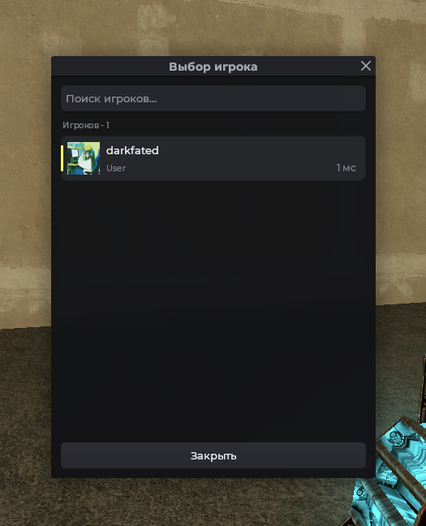

# Player selector

A window listing the players on the server. Players are sorted by name, and you can show only those matching a condition.

## Example



```js
Mantle.ui.player_selector(function(pl)
    print('Selected player:', pl:Name())
end)
```

## With a player filter

The second argument decides who ends up in the list. For example, only your team:

```js
Mantle.ui.player_selector(function(pl)
    print('Selected:', pl:Name())
end, function(pl)
    return pl:Team() == TEAM_CITIZEN
end)
```

## Opening it from your UI

```js
local frame = vgui.Create('MantleFrame')
frame:SetSize(600, 500)
frame:Center()
frame:MakePopup()

local btn = vgui.Create('MantleBtn', frame)
btn:SetSize(160, 40)
btn:Center()
btn:SetTxt('Grant admin')

btn.DoClick = function()
    Mantle.ui.player_selector(function(pl)
        RunConsoleCommand('grantrole', pl:SteamID(), 'admin')
    end)
end
```

## Arguments

| Argument   | Type       | Description                                                       |
| ---------- | ---------- | ----------------------------------------------------------------- |
| `onSelect` | `function` | Called with the selected player                                   |
| `filterFn` | `function` | Filter. Return `true` to include the player. Optional             |
