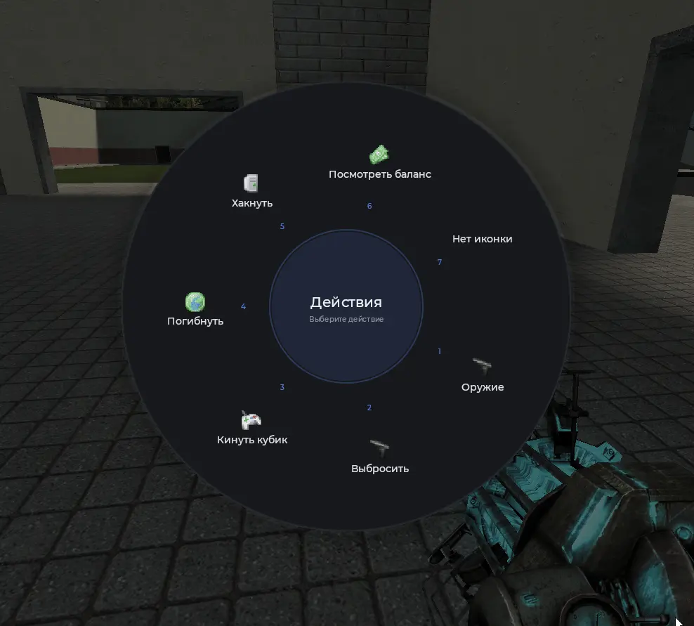
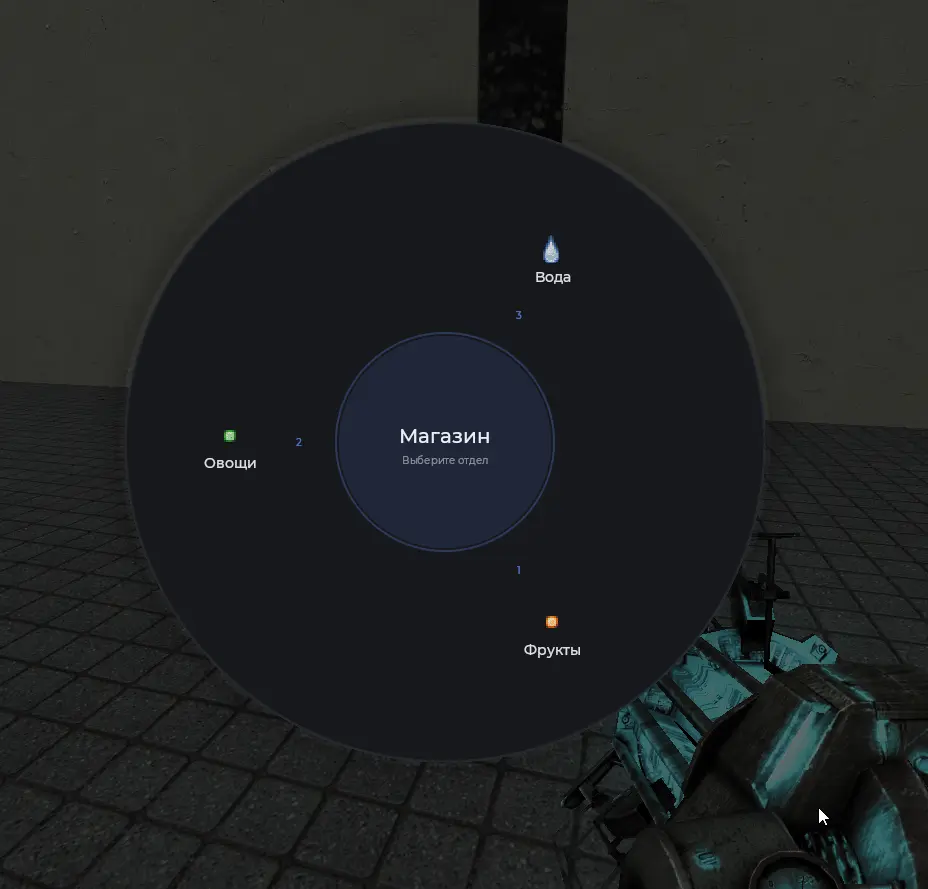

# Radial menu

A ring menu with options around the center. Controlled from the keyboard (digits 1-9), ESC closes it, and clicking the center goes back. Supports nested submenus.



## Example

```js
local menu = Mantle.ui.radial_menu({
    title = 'Cart',
    desc = 'Pick a product',
    radius = 320,
    inner_radius = 110,
    font = 'Fated.20',
    title_font = 'Fated.28',
    desc_font = 'Fated.14'
})

local cart = {}
local total = 0

local function addItem(name, price)
    cart[#cart + 1] = name
    total = total + price
    chat.AddText(Mantle.color.theme, 'Added to cart: ' .. name .. ' (+$' .. price .. ')')
    menu:SetCenterText('Cart', 'Total: $' .. total)
end

menu:AddOption('Apple', function()
    addItem('Apple', 40)
end, 'icon16/bullet_red.png', 'Red apple, $40')

menu:AddOption('Banana', function()
    addItem('Banana', 30)
end, 'icon16/bullet_yellow.png', 'Ripe banana, $30')

menu:AddOption('Cucumber', function()
    addItem('Cucumber', 25)
end, 'icon16/bullet_green.png', 'Crisp cucumber, $25')
```

## Submenus

A nested menu is created with `:CreateSubMenu` and attached to an item with `:AddSubMenuOption`.



```js
local menu = Mantle.ui.radial_menu({ title = 'Shop', desc = 'Pick a department' })

local fruits = menu:CreateSubMenu('Fruits', 'What will you take?')
fruits:AddOption('Apple', function()
    chat.AddText(Mantle.color.theme, 'Apple purchased')
end, 'icon16/bullet_red.png', '$40')
fruits:AddOption('Pear', function()
    chat.AddText(Mantle.color.theme, 'Pear purchased')
end, 'icon16/bullet_yellow.png', '$35')

local vegetables = menu:CreateSubMenu('Vegetables', 'What will you take?')
vegetables:AddOption('Tomato', function()
    chat.AddText(Mantle.color.theme, 'Tomato purchased')
end, 'icon16/bullet_red.png', '$30')
vegetables:AddOption('Cabbage', function()
    chat.AddText(Mantle.color.theme, 'Cabbage purchased')
end, 'icon16/bullet_green.png', '$50')

menu:AddSubMenuOption('Fruits', fruits, 'icon16/bullet_orange.png', 'Sweet fruits')
menu:AddSubMenuOption('Vegetables', vegetables, 'icon16/bullet_green.png', 'Fresh vegetables')
menu:AddOption('Water', function()
    chat.AddText(Mantle.color.theme, 'Water purchased')
end, 'icon16/water.png', 'A bottle of water')
```

## Customizing the look

```js
local menu = Mantle.ui.radial_menu({
    title = 'Menu',
    desc = 'Pick an action',
    radius = 320,
    inner_radius = 110,
    font = 'Fated.20',
    title_font = 'Fated.28',
    desc_font = 'Fated.14'
})
```

## Creation parameters

| Parameter            | Type     | Default                | Description                    |
| -------------------- | -------- | ---------------------- | ------------------------------ |
| `title`              | `string` | `Menu`                 | Title in the center            |
| `desc`               | `string` | `Pick an option`       | Subtitle in the center         |
| `radius`             | `number` | `320`                  | Outer radius of the menu       |
| `inner_radius`       | `number` | `110`                  | Radius of the central area     |
| `title_font`         | `string` | `Fated.28`             | Title font                     |
| `font`               | `string` | `Fated.20`             | Option font                    |
| `desc_font`          | `string` | `Fated.14`             | Subtitle font                  |
| `fade_in_time`       | `number` | `0.18`                 | Appearance duration            |
| `fade_out_time`      | `number` | `0.12`                 | Close duration                 |
| `scale_animation`    | `bool`   | `true`                 | Scale-in animation from center |
| `disable_background` | `bool`   | `false`                | Disable the background dim     |
| `hover_sound`        | `string` | `mantle/ratio_btn.ogg` | Sound when hovering an option  |

## Methods

| Method                                                                                           | Description                                     |
| ------------------------------------------------------------------------------------------------ | ----------------------------------------------- |
| `:AddOption(string text, function func, string icon, string desc, table submenu, bool disabled)` | Add an option. Returns its index                |
| `:CreateSubMenu(string title, string desc)`                                                      | Create a submenu. Returns the submenu           |
| `:AddSubMenuOption(string text, table submenu, string icon, string desc)`                        | Add an option that leads into a submenu         |
| `:ApplySettings(table settings)`                                                                 | Apply appearance settings from a config table   |
| `:SelectOption(int index)`                                                                       | Select an option programmatically               |
| `:SetCenterText(string title, string desc)`                                                      | Text in the center of the menu                  |
| `:GetCurrentOptions()`                                                                           | Options of the current menu (or submenu)        |
| `:GoBack()`                                                                                      | Go back to the previous menu                    |
| `:CloseMenu(function callback)`                                                                  | Close the menu. The callback runs after closing |
| `:IsMouseOver()`                                                                                 | `true` if the cursor is inside the menu         |

## Controls

- Keys `1`-`9` select an option.
- Clicking the center returns to the previous submenu (or closes the menu if there is none).
- Clicking outside the menu or pressing `ESC` closes the ring panel.
