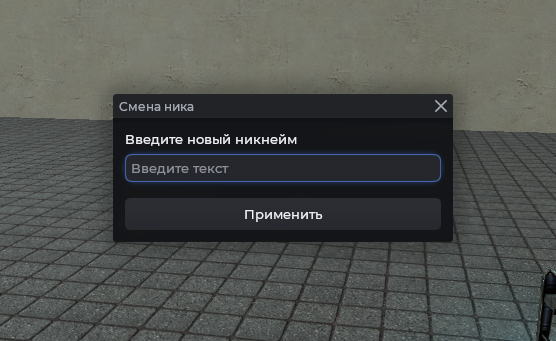

# Text box

A window with an input field. Suited for short input: nicknames, commands, numbers. Open it with `Mantle.ui.text_box(title, desc, callback)`.

## Example



```js
Mantle.ui.text_box('Change nickname', 'Enter a new nickname', function(text)
    print('New nick:', text)
end)
```

## Accepting a number

```js
Mantle.ui.text_box('Range', 'Maximum distance', function(text)
    local value = tonumber(text)
    if !value then
        print('Invalid number')
        return
    end
    print('Range:', value)
end)
```

## Arguments

| Argument   | Type       | Description                     |
| ---------- | ---------- | ------------------------------- |
| `title`    | `string`   | Window title                    |
| `desc`     | `string`   | Explanation under the title     |
| `callback` | `function` | Called with the entered text    |
