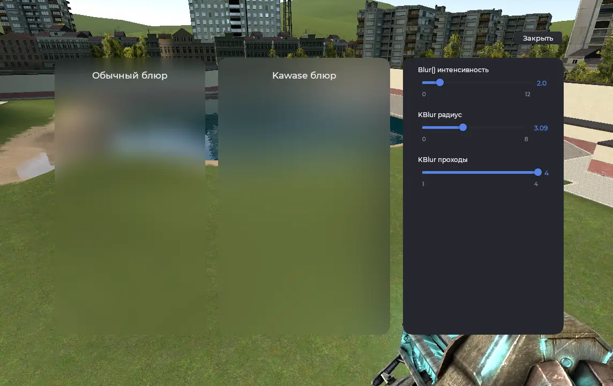
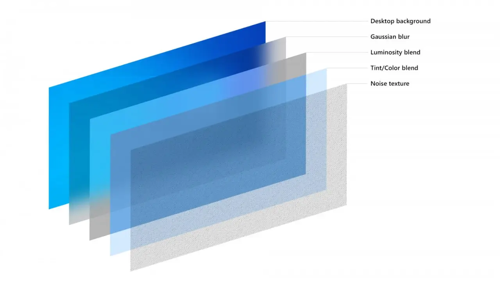

# Modified RNDX

Fast drawing of graphical primitives (a replacement for `draw`). This is a fork of the original library.

## Rectangle

```js
hook.Add('HUDPaint', 'Test', function()
    local w, h = 300, 120
    local x, y = (ScrW() - w) / 2, (ScrH() - h) / 2

    RNDX.Rect(x, y, w, h)
        :Rad(16)
        :Color(Mantle.color.panel[1])
    :Draw()
end)
```

## Corner radius

```js
hook.Add('HUDPaint', 'Test', function()
    local w, h = 300, 120
    local x, y = (ScrW() - w) / 2, (ScrH() - h) / 2

    RNDX.Rect(x, y, w, h)
        :Radii(16, 16, 0, 0) -- rounded on top, square on the bottom
        :Color(Mantle.color.panel[1])
    :Draw()
end)
```

## Outline

```js
hook.Add('HUDPaint', 'Test', function()
    local w, h = 300, 120
    local x, y = (ScrW() - w) / 2, (ScrH() - h) / 2

    RNDX.Rect(x, y, w, h)
        :Rad(16)
        :Outline(2)
        :Color(Mantle.color.panel[1])
    :Draw()
end)
```

## Circle

```js
hook.Add('HUDPaint', 'Test', function()
    local cx, cy = ScrW() / 2, ScrH() / 2

    RNDX.Circle(cx, cy, 30)
        :Color(Color(182, 65, 65))
    :Draw()
end)
```

## Shadow under a shape

```js
hook.Add('HUDPaint', 'Test', function()
    local w, h = 300, 120
    local x, y = (ScrW() - w) / 2, (ScrH() - h) / 2

    RNDX.Rect(x, y, w, h)
        :Rad(16)
        :Shadow(20, 4, 0, 2)
    :Draw()

    RNDX.Rect(x, y, w, h)
        :Rad(16)
        :Color(Mantle.color.panel[1])
    :Draw()
end)
```

## Background blur

```js
hook.Add('HUDPaint', 'Test', function()
    local w, h = 300, 120
    local x, y = (ScrW() - w) / 2, (ScrH() - h) / 2

    RNDX.Rect(x, y, w, h)
        :Rad(16)
        :Blur(2)
    :Draw()
end)
```

## Kawase background blur



```js
local blur = 2
local kradius = 1
local kiterations = 4

local function addSlider(parent, text, min, max, decimals, value, setter)
    local slider = vgui.Create('MantleSlideBox', parent)
    slider:Dock(TOP)
    slider:DockMargin(12, 8, 12, 8)
    slider:SetText(text)
    slider:SetRange(min, max, decimals)
    slider:SetValue(value)
    slider.OnValueChanged = function(_, val)
        setter(val)
    end
end

local function openMenu()
    local frame = vgui.Create('DFrame')
    frame:SetSize(960, 600)
    frame:Center()
    frame:MakePopup()
    frame:SetTitle('')
    frame:ShowCloseButton(false)
    frame:SetDraggable(true)
    frame.Paint = nil

    local btnClose = vgui.Create('MantleBtn', frame)
    btnClose:SetSize(90, 24)
    btnClose:SetPos(frame:GetWide() - 98, 4)
    btnClose:SetTxt('Close')
    btnClose:SetRadius(8)
    btnClose.DoClick = function()
        frame:Remove()
    end

    local settings = vgui.Create('Panel', frame)
    settings:Dock(RIGHT)
    settings:SetWide(300)
    settings:DockMargin(24, 24, 0, 24)
    settings.Paint = function(_, w, h)
        RNDX.Rect(0, 0, w, h)
            :Rad(32)
            :Color(Mantle.color.panel[2])
        :Draw()
    end

    addSlider(settings, 'Blur() intensity', 0, 12, 1, blur, function(v) blur = v end)
    addSlider(settings, 'KBlur radius', 0, 8, 2, kradius, function(v) kradius = v end)
    addSlider(settings, 'KBlur passes', 1, 4, 0, kiterations, function(v) kiterations = v end)

    local main = vgui.Create('Panel', frame)
    main:Dock(FILL)
    main.Paint = nil

    local left = vgui.Create('Panel', main)
    left:Dock(LEFT)
    left:DockMargin(0, 24, 12, 24)
    left.Paint = function(self, w, h)
        RNDX.Rect(0, 0, w, h)
            :Rad(32)
            :Blur(blur)
        :Draw()
        draw.SimpleText('Regular blur', 'Fated.24', w * 0.5, 20, Mantle.color.text, TEXT_ALIGN_CENTER)
    end

    local right = vgui.Create('Panel', main)
    right:Dock(FILL)
    right:DockMargin(12, 24, 0, 24)
    right.Paint = function(self, w, h)
        RNDX.Rect(0, 0, w, h)
            :Rad(32)
            :KBlur(kiterations, kradius)
        :Draw()
        draw.SimpleText('Kawase blur', 'Fated.24', w * 0.5, 20, Mantle.color.text, TEXT_ALIGN_CENTER)
    end

    main.PerformLayout = function(self, w)
        left:SetWide(w * 0.45)
    end
end

concommand.Add('mantle_test_blur', function()
    openMenu()
end)
```

The recommended value is `:KBlur(4, 2)`.

## Acrylic material

This is a ready-made frosted glass effect in the spirit of **Windows 11**. Instead of a flat translucent rectangle, the library combines five layers at once:

| Layer | What it does |
| --- | --- |
| **blur** | background blur |
| **burn** | dimming of bright areas |
| **tint** | color tint |
| **noise** | light grain |
| **fresnel** | soft glow at the edges |



```js
local acrylic = {
    blur = { enabled = true, iterations = 4, radius = 4 },
    burn = { enabled = true, color = Color(120, 120, 120), amount = 0.4 },
    tint = { enabled = true, color = Color(25, 25, 25), amount = 0.4 },
    noise = { enabled = true, intensity = 0.02, scale = 8 },
    fresnel = { enabled = true, color = Color(70, 140, 230), amount = 0.3, width = 1.4 }
}

hook.Add('HUDPaint', 'Test', function()
    RNDX.Rect(100, 100, 400, 200)
        :Rad(16)
        :Acrylic(acrylic)
    :Draw()
end)
```

## Circle sector

```js
hook.Add('HUDPaint', 'Test', function()
    local cx, cy = ScrW() / 2, ScrH() / 2

    -- Angle in degrees: 0 to 180 (bottom half-circle)
    RNDX.Circle(cx, cy, 40)
        :Angles(0, 180)
        :Color(Mantle.color.theme)
    :Draw()
end)
```

## Drawing a material

```js
hook.Add('HUDPaint', 'Test', function()
    local w, h = 300, 120
    local x, y = (ScrW() - w) / 2, (ScrH() - h) / 2

    RNDX.Rect(x, y, w, h)
        :Rad(12)
        :Material(Material('icon16/user.png'))
    :Draw()
end)
```

## Constructors

| Constructor                             | Description       |
| --------------------------------------- | ----------------- |
| `RNDX.Rect(int x, int y, int w, int h)` | Rectangle         |
| `RNDX.Circle(int x, int y, int radius)` | Circle by center  |

## Modifiers

| Modifier                                                    | Description                                                             |
| ----------------------------------------------------------- | ----------------------------------------------------------------------- |
| `:Rad(int rad)` / `:Radii(int tl, int tr, int bl, int br)`  | Corner radius                                                           |
| `:Color(color col)`                                         | Fill color                                                              |
| `:Outline(int thickness)`                                   | Outline instead of fill. Defaults to 1                                  |
| `:Texture(ITexture)` / `:Material(IMaterial)`               | Draw a texture / material                                               |
| `:Blur(int intensity)`                                      | Blur the background inside the shape                                    |
| `:KBlur(int iterations, int radius)`                        | Kawase blur of the background inside the shape                          |
| `:Fade(int top, int bottom)`                                | Vertical fade. For example, `:Fade(1, 0)` is transparent at the bottom  |
| `:Shadow(int blur, int spread, int offset_x, int offset_y)` | Shadow under the shape                                                  |
| `:Rotation(int deg)`                                        | Rotate the shape                                                        |
| `:Angles(int start, int end)`                               | Circle sector                                                           |
| `:StartAngle(int deg)` / `:EndAngle(int deg)`               | Start and end angle of the sector                                       |
| `:Shape(int shape)`                                         | Corner shape: `RNDX.SHAPE_CIRCLE`, `RNDX.SHAPE_FIGMA`, `RNDX.SHAPE_IOS` |
| `:ManualColor()`                                            | Do not set the color automatically (manual color control)               |
| `:Alpha(number alpha)`                                      | Blur opacity (`0..1`)                                                   |
| `:Clip(object panel)`                                       | Clip drawing to the panel bounds                                        |
| `:Flags(int flags)`                                         | Fast flags: `RNDX.NO_TL/TR/BL/BR`, `RNDX.BLUR`, `RNDX.MANUAL_COLOR`     |
| `:Draw()`                                                   | Finish and draw the shape                                               |
| `:GetMaterial()`                                            | Get the material instead of drawing. Unavailable for shadows and blur   |

## Defaults

```js
RNDX.SetDefaultShape(RNDX.SHAPE_FIGMA) -- corner shape
RNDX.SetDefaultBlurIntensity(1) -- :Blur() intensity
RNDX.SetDefaultKBlurIterations(4) -- :KBlur() passes

print(RNDX.GetDefaultBlurIntensity())
print(RNDX.GetDefaultKBlurIterations())
```
