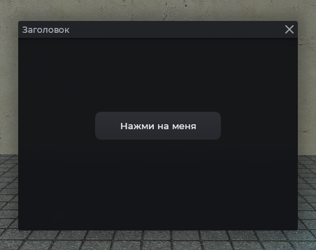
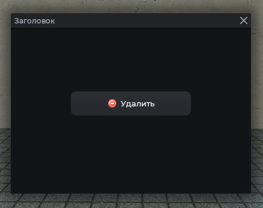
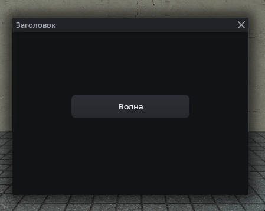
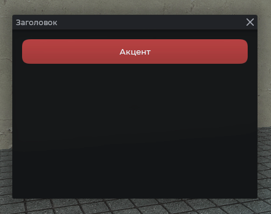
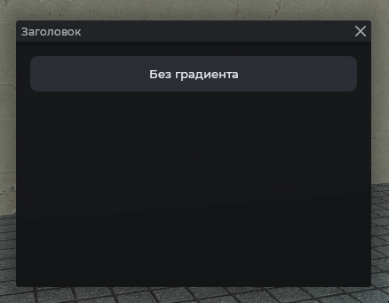
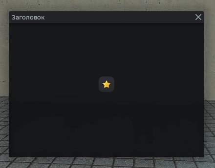

# MantleBtn

A button with color options, a ripple effect, and more.

## Example



```js
local frame = vgui.Create('MantleFrame')
frame:SetSize(600, 400)
frame:Center()
frame:MakePopup()

local btn = vgui.Create('MantleBtn', frame)
btn:SetSize(180, 60)
btn:Center()
btn:SetTxt('Click me')
btn.DoClick = function()
    chat.AddText('Hello World')
    chat.PlaySound()
end
```

## With an icon

You can pass an icon either as a string path: `:SetIcon("icon16/example.png", 16)` or as a material: `:SetIcon(mat_icon, 16)`.



```js
local frame = vgui.Create('MantleFrame')
frame:SetSize(600, 500)
frame:Center()
frame:MakePopup()

local btnIcon = vgui.Create('MantleBtn', frame)
btnIcon:SetSize(200, 40)
btnIcon:Center()
btnIcon:SetTxt('Delete')
btnIcon:SetIcon(Material('icon16/delete.png'), 16)
```

## With a ripple effect

The ripple is drawn from the click position. Enable it with `:SetRipple(true)`.



```js
local frame = vgui.Create('MantleFrame')
frame:SetSize(600, 500)
frame:Center()
frame:MakePopup()

local btnRipple = vgui.Create('MantleBtn', frame)
btnRipple:SetSize(200, 40)
btnRipple:SetTxt('Ripple')
btnRipple:SetRipple(true)
```

## Changing the look

Button parameters can be overridden; the full list is in Methods.



```js
local frame = vgui.Create('MantleFrame')
frame:SetSize(600, 500)
frame:Center()
frame:MakePopup()

local btn = vgui.Create('MantleBtn', frame)
btn:Dock(TOP)
btn:SetTall(40)
btn:DockMargin(8, 8, 8, 8)
btn:SetTxt('Accent')
btn:SetColor(Color(182, 65, 65))
btn:SetColorHover(Color(210, 90, 90))
btn:SetRadius(32)
```

Disabling the gradient and the hover highlight:



```js
local frame = vgui.Create('MantleFrame')
frame:SetSize(600, 500)
frame:Center()
frame:MakePopup()

local btn = vgui.Create('MantleBtn', frame)
btn:Dock(TOP)
btn:SetTall(40)
btn:DockMargin(8, 8, 8, 8)
btn:SetTxt('No gradient')
btn:SetGradient(false)
btn:SetHover(false)
```

## Icon button

If no text is set, the button centers its icon.



```js
local frame = vgui.Create('MantleFrame')
frame:SetSize(600, 500)
frame:Center()
frame:MakePopup()

local iconBtn = vgui.Create('MantleBtn', frame)
iconBtn:SetSize(32, 32)
iconBtn:Center()
iconBtn:SetTxt('')
iconBtn:SetIcon(Material('icon16/star.png'), 16)
```

## Methods

| Method                                      | Description                                          |
| ------------------------------------------- | ---------------------------------------------------- |
| `:SetTxt(string text)`                      | Button text                                          |
| `:SetFont(string font)`                     | Font. Default `Fated.18`                             |
| `:SetColor(color color)`                    | Base button color                                    |
| `:SetColorHover(color color)`               | Hover color                                          |
| `:SetRadius(int rad)`                       | Corner radius. Default `12`                          |
| `:SetGradient(bool enabled)`                | Gradient at the bottom of the button. Default `true` |
| `:SetRipple(bool enabled)`                  | Click ripple effect. Default `false`                 |
| `:SetHover(bool isHover)`                   | Hover highlight. Default `true`                      |
| `:SetIcon(string\|material icon, int size)` | Icon                                                 |

## Notes

- The remaining methods are inherited from [DButton](https://wiki.facepunch.com/gmod/DButton).
- The default button colors come from the Mantle theme; setting custom values means the theme will no longer change the colors.
- The built-in `DoClick` plays `mantle/btn_click.ogg` via `Mantle.func.sound()`. If you override `DoClick`, call the sound manually: `Mantle.func.sound()`.
