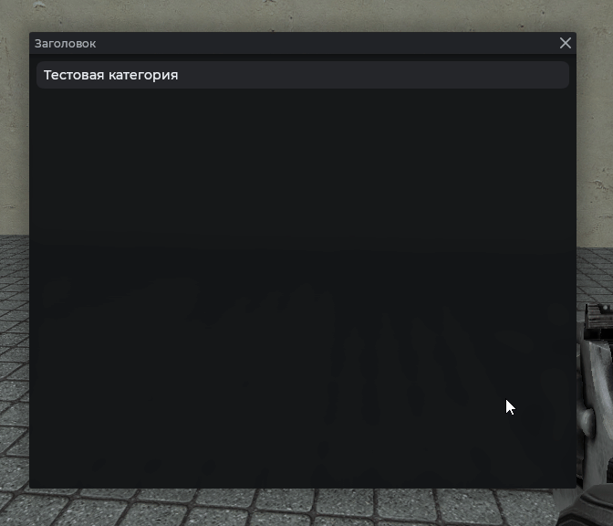
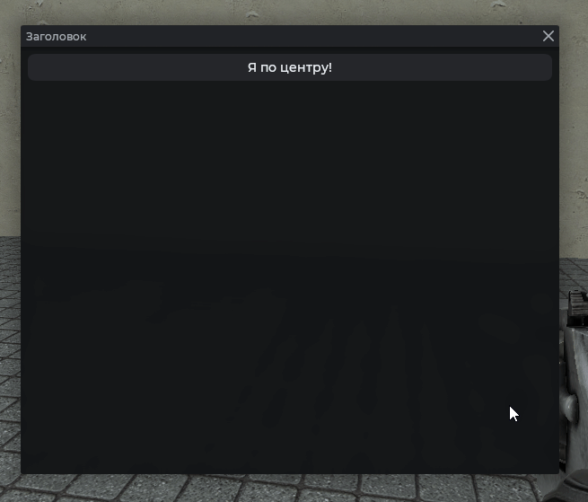

# MantleCategory

A collapsible block with a header and content. Clicking the header expands or hides the content.

## Example



```js
local frame = vgui.Create('MantleFrame')
frame:SetSize(600, 500)
frame:Center()
frame:MakePopup()

local cat = vgui.Create('MantleCategory', frame)
cat:Dock(TOP)
cat:SetText('Test category')

local pan = vgui.Create('MantleText', cat)
pan:Dock(TOP)
pan:SetTall(300)
pan.Paint = function(_, w, h)
    RNDX.Rect(0, 0, w, h)
        :Rad(32)
        :Color(Color(230, 150, 150))
    :Draw()
end
```

## Expanded by default

```js
local frame = vgui.Create('MantleFrame')
frame:SetSize(600, 500)
frame:Center()
frame:MakePopup()

local cat = vgui.Create('MantleCategory', frame)
cat:Dock(TOP)
cat:SetActive(true) -- false by default

local pan = vgui.Create('DPanel', cat)
pan:Dock(TOP)
pan:SetTall(300)
```

## Checking the state

```js
local frame = vgui.Create('MantleFrame')
frame:SetSize(600, 500)
frame:Center()
frame:MakePopup()

local cat = vgui.Create('MantleCategory', frame)
cat:Dock(TOP)
cat:SetText('Block')

if !cat:IsActive() then
    print('The category is collapsed')
end
```

## Centering the header



```js
local frame = vgui.Create('MantleFrame')
frame:SetSize(600, 500)
frame:Center()
frame:MakePopup()

local cat = vgui.Create('MantleCategory', frame)
cat:Dock(TOP)
cat:SetText('I am centered!')
cat:SetCenterText(true)

local pan = vgui.Create('MantleText', cat)
pan:Dock(TOP)
pan:SetTall(300)
pan.Paint = function(_, w, h)
    RNDX.Rect(0, 0, w, h)
        :Rad(32)
        :Color(Mantle.color.panel_alpha[2])
    :Draw()
end
```

## Custom header color

```js
local frame = vgui.Create('MantleFrame')
frame:SetSize(600, 500)
frame:Center()
frame:MakePopup()

local cat = vgui.Create('MantleCategory', frame)
cat:Dock(TOP)
cat:SetText('Important')
cat:SetColor(Color(182, 65, 65))
```

## Methods

| Method                            | Description                               |
| --------------------------------- | ----------------------------------------- |
| `:SetText(string text)`           | Category header                           |
| `:AddItem(panel)`                 | Add a panel to the content                |
| `:SetColor(color col)`            | Header color                              |
| `:SetCenterText(bool isCentered)` | Center the header. Default `false`        |
| `:SetActive(bool isActive)`       | Expand or collapse the category           |
| `:IsActive()`                     | `true` if the category is expanded        |
| `:Clear()`                        | Clear the content                         |

## Notes

- The category is collapsed by default.
