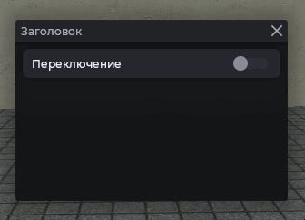

# MantleCheckBox

A toggle with a label and a circle. It can be bound to a ConVar, in which case the value stays in sync automatically.

## Example



```js
local frame = vgui.Create('MantleFrame')
frame:SetSize(600, 500)
frame:Center()
frame:MakePopup()

local checkbox = vgui.Create('MantleCheckBox', frame)
checkbox:SetWide(300)
checkbox:Center()
checkbox:SetTxt('Toggle')
```

## Reading the state

```js
local frame = vgui.Create('MantleFrame')
frame:SetSize(600, 500)
frame:Center()
frame:MakePopup()

local checkbox = vgui.Create('MantleCheckBox', frame)
checkbox:SetWide(300)
checkbox:Center()
checkbox:SetTxt('Test')

print(checkbox:GetBool())
```

## Setting the value

```js
local frame = vgui.Create('MantleFrame')
frame:SetSize(600, 500)
frame:Center()
frame:MakePopup()

local checkbox = vgui.Create('MantleCheckBox', frame)
checkbox:SetWide(300)
checkbox:Center()
checkbox:SetTxt('On from the start')

checkbox:SetValue(true)

print(checkbox:GetBool()) -- true
```

## Binding to a ConVar

When the element is created, the ConVar value is read and mapped from `0`/`1`.

```js
local frame = vgui.Create('MantleFrame')
frame:SetSize(600, 500)
frame:Center()
frame:MakePopup()

local checkbox = vgui.Create('MantleCheckBox', frame)
checkbox:SetWide(300)
checkbox:Center()
checkbox:SetTxt('Interface')
checkbox:SetConvar('cl_drawhud')
```

## Handling changes

Override `:OnChange`. It is called on any change: a click, `SetValue`, or a ConVar sync.

```js
local frame = vgui.Create('MantleFrame')
frame:SetSize(600, 500)
frame:Center()
frame:MakePopup()

local checkbox = vgui.Create('MantleCheckBox', frame)
checkbox:SetWide(300)
checkbox:Center()
checkbox:SetTxt('Sound')
checkbox.OnChange = function(self, value)
    if value then
        print('Sound enabled')
    else
        print('Sound disabled')
    end
end
```

## Methods

| Method                                  | Description                     |
| --------------------------------------- | ------------------------------- |
| `:SetTxt(string text)`                  | Label                           |
| `:SetText(string text)`                 | Alias for `SetTxt`              |
| `:GetText()`                            | Current label                   |
| `:SetValue(bool value)`                 | Set the state (on/off)          |
| `:GetBool()`                            | Current toggle state            |
| `:GetValue()`                           | Alias for `GetBool`             |
| `:SetConvar(string convar)`             | Bind to a ConVar                |
| `:OnChange(panel self, bool new_value)` | Called when the toggle changes  |

## Notes

- When the element is removed, its ConVar sync timer is cleaned up automatically.
