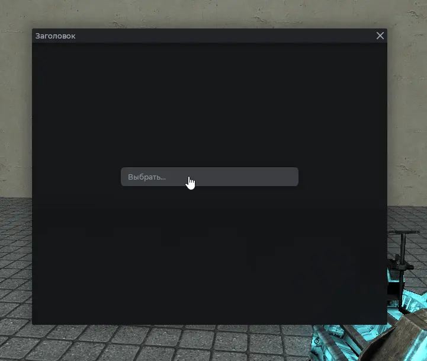

# MantleComboBox

A dropdown list. Each option can carry extra data that is returned when it is selected.

## Example



```js
local frame = vgui.Create('MantleFrame')
frame:SetSize(600, 500)
frame:Center()
frame:MakePopup()

local combo = vgui.Create('MantleComboBox', frame)
combo:SetWide(300)
combo:Center()
combo:AddChoice('Day')
combo:AddChoice('Night')
combo:AddChoice('Evening')
```

## Selecting from code

```js
local frame = vgui.Create('MantleFrame')
frame:SetSize(600, 500)
frame:Center()
frame:MakePopup()

local combo = vgui.Create('MantleComboBox', frame)
combo:SetWide(300)
combo:Center()
combo:AddChoice('Red')
combo:AddChoice('Blue')

combo:SetValue('Blue')
print(combo:GetValue()) -- "Blue"
```

## Handling selection

Override `:OnSelect`. The arguments are the option index, its text, and the extra data.

```js
local frame = vgui.Create('MantleFrame')
frame:SetSize(600, 500)
frame:Center()
frame:MakePopup()

local combo = vgui.Create('MantleComboBox', frame)
combo:SetWide(300)
combo:Center()
combo:AddChoice('Light', {"Stick", "Stone"})
combo:AddChoice('Medium', 256)
combo:AddChoice('Heavy', {64, 64, 96})

combo.OnSelect = function(index, text, data)
    print('Selected:', index, text, data)
end
```

## Placeholder

Until something is selected, a gray hint is displayed.

```js
local frame = vgui.Create('MantleFrame')
frame:SetSize(600, 500)
frame:Center()
frame:MakePopup()

local combo = vgui.Create('MantleComboBox', frame)
combo:SetWide(300)
combo:Center()
combo:SetPlaceholder('Pick a mode...')

combo:AddChoice('Survival')
combo:AddChoice('Creative')
```

## Methods

| Method                                        | Description                          |
| --------------------------------------------- | ------------------------------------ |
| `:AddChoice(string text, any data)`           | Add an option. Returns its index     |
| `:SetValue(string text)`                      | Select an option by its text         |
| `:GetValue()`                                 | Text of the selected option          |
| `:SelectChoice(int index)`                    | Select an option by index            |
| `:SetPlaceholder(string text)`                | Hint shown while nothing is selected |
| `:OpenMenu()`                                 | Open the list                        |
| `:CloseMenu()`                                | Close the list                       |
| `:OnSelect(int index, string text, any data)` | Called on selection                  |

## Notes

- The list closes when you click outside it.
- If `SetValue` is called with text that is not in the list, the selection is reset.
