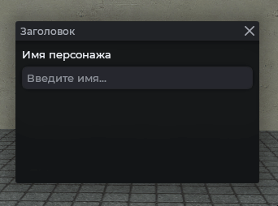
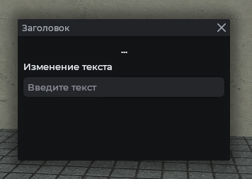

# MantleEntry

An input field with a title and a placeholder. It is built on `DTextEntry`, so all of its methods are available, for example `panel.textEntry:SetNumeric(true)`.

## Example



```js
local frame = vgui.Create('MantleFrame')
frame:SetSize(600, 500)
frame:Center()
frame:MakePopup()

local entry = vgui.Create('MantleEntry', frame)
entry:SetWide(400)
entry:Center()
entry:SetTitle('Character name')
entry:SetPlaceholder('Enter a name...')
```

## Reading and writing the value

```js
local frame = vgui.Create('MantleFrame')
frame:SetSize(600, 500)
frame:Center()
frame:MakePopup()

local entry = vgui.Create('MantleEntry', frame)
entry:SetWide(400)
entry:Center()
entry:SetTitle('Character name')

entry:SetValue('darkf')
print(entry:GetValue()) -- "darkf"
```

## Handling input

The `action` event fires when the field loses focus (clicking outside it or pressing Enter).



```js
local frame = vgui.Create('MantleFrame')
frame:SetSize(600, 500)
frame:Center()
frame:MakePopup()

local text = '...'
local pan = vgui.Create('Panel', frame)
pan:Dock(TOP)
pan:SetTall(20)
pan.Paint = function(_, w, h)
    draw.SimpleText(text, 'Fated.20', w * 0.5, h * 0.5, color_white, 1, 1)
end

local entry = vgui.Create('MantleEntry', frame)
entry:Dock(TOP)
entry:DockMargin(0, 6, 0, 0)
entry:SetTitle('Text change')
entry.action = function(value)
    text = value
end
```

## Numeric field

```js
local frame = vgui.Create('MantleFrame')
frame:SetSize(600, 500)
frame:Center()
frame:MakePopup()

local entry = vgui.Create('MantleEntry', frame)
entry:SetWide(400)
entry:Center()
entry:SetTitle('Amount')
entry:SetPlaceholder('Digits only')

entry.textEntry:SetNumeric(true)
```

## Handling Enter

```js
local frame = vgui.Create('MantleFrame')
frame:SetSize(600, 500)
frame:Center()
frame:MakePopup()

local entry = vgui.Create('MantleEntry', frame)
entry:SetWide(400)
entry:Center()
entry:SetTitle('Character name')

entry.textEntry.OnEnter = function()
    local value = entry:GetValue()
    if value == '' then return end

    print('Entered name:', value)
end
```

## Methods

| Method                         | Description                              |
| ------------------------------ | ---------------------------------------- |
| `:SetTitle(string text)`       | Title above the field                    |
| `:SetPlaceholder(string text)` | Gray hint shown while the field is empty |
| `:GetValue()`                  | Text from the field                      |
| `:SetValue(string value)`      | Put text into the field                  |

## Notes

- The field scrolls its text horizontally automatically once the cursor moves past the edge.
