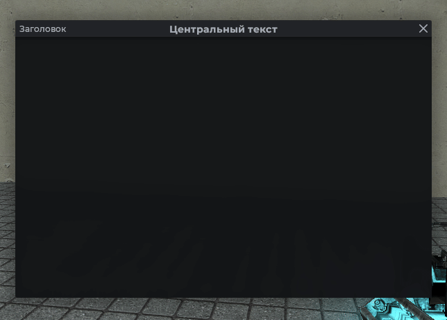
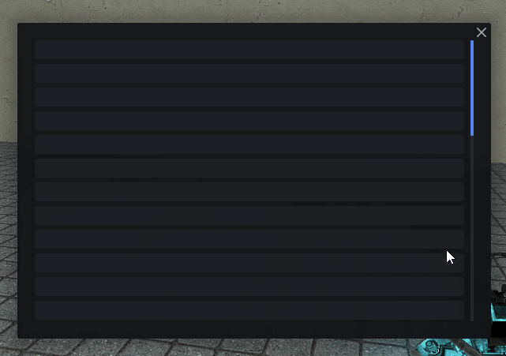
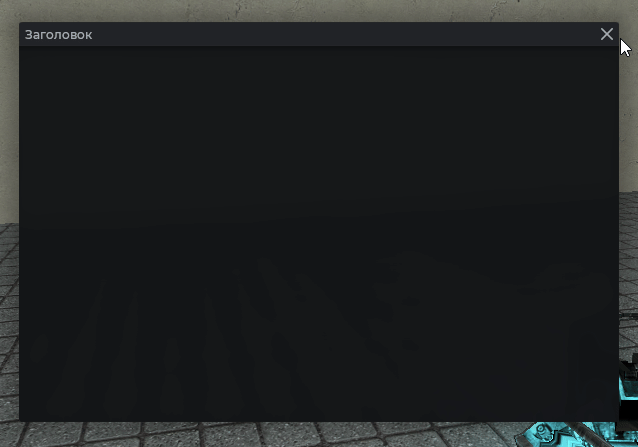
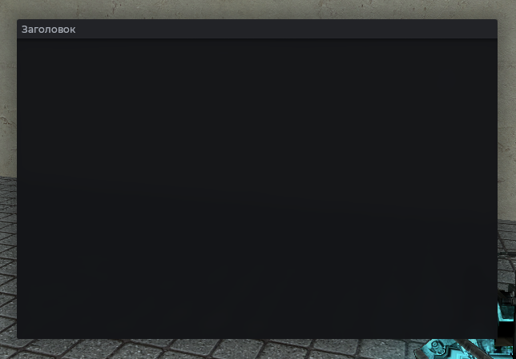
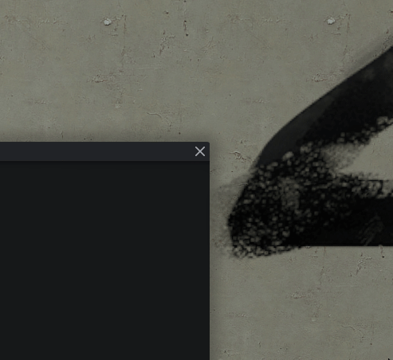

# MantleFrame

A window implementation for holding elements.

## Example



```js
local frame = vgui.Create('MantleFrame')
frame:SetSize(600, 500)
frame:Center()
frame:MakePopup()
frame:SetTitle('Title')
frame:SetCenterTitle('Centered text')
frame:ShowAnimation()
```

## Titles

`SetTitle` draws a title on the left, `SetCenterTitle` in the middle of the header.

```js
local frame = vgui.Create('MantleFrame')
frame:SetSize(600, 500)
frame:Center()
frame:MakePopup()
frame:SetTitle('Left')
frame:SetCenterTitle('Center')
```

## Smooth open and close

```js
local frame = vgui.Create('MantleFrame')
frame:SetSize(600, 500)
frame:Center()
frame:ShowAnimation() -- animation method

-- Closing
timer.Simple(2, function()
    if IsValid(frame) then
        frame:Close()
    end
end)
```

## Disabling drag by the header

```js
local frame = vgui.Create('MantleFrame')
frame:SetSize(600, 500)
frame:Center()
frame:MakePopup()
frame:SetDraggable(false)
```

## Headerless mode

Removes the header and the titles. Suited for popup menus.



```js
local frame = vgui.Create('MantleFrame')
frame:SetSize(600, 500)
frame:Center()
frame:MakePopup()
frame:LiteMode()

local sp = vgui.Create('MantleScrollPanel', frame)
sp:Dock(FILL)

for k = 1, 35 do
    local pan = vgui.Create('DPanel', sp)
    pan:Dock(TOP)
    pan:DockMargin(0, 0, 0, 6)
    pan.Paint = function(_, w, h)
        draw.RoundedBox(6, 0, 0, w, h, Mantle.color.panel_alpha[2])
    end
end
```

## Transparent background

Toggles the blurred background. It is enabled by default.

```js
local frame = vgui.Create('MantleFrame')
frame:SetSize(600, 500)
frame:Center()
frame:MakePopup()

frame:SetAlphaBackground(true)
```

## Notification at the bottom of the window



```js
local frame = vgui.Create('MantleFrame')
frame:SetSize(600, 500)
frame:Center()
frame:MakePopup()

timer.Simple(1.5, function()
    frame:Notify('Saved', 2) -- text, duration
end)
```

## Hiding the close button



```js
local frame = vgui.Create('MantleFrame')
frame:SetSize(600, 500)
frame:Center()
frame:MakePopup()
frame:DisableCloseBtn()

timer.Simple(5, function()
    frame:Close()
end)
```

## Methods

| Method                                  | Description                                                         |
| --------------------------------------- | ------------------------------------------------------------------- |
| `:SetTitle(string title)`               | Title on the left of the header                                     |
| `:SetCenterTitle(string centerTitle)`   | Title in the center of the header                                   |
| `:SetAlphaBackground(bool isAlpha)`     | Transparent window background. Default `true`                       |
| `:SetDraggable(bool isDraggable)`       | Window dragging. Default `true`                                     |
| `:ShowAnimation()`                      | Window appearance animation                                         |
| `:Close()`                              | Close the window                                                    |
| `:DisableCloseBtn()`                    | Hide the close button                                               |
| `:LiteMode()`                           | Headerless mode                                                     |
| `:Notify(string text, number duration)` | Notification at the bottom of the window. Default duration `2 sec.` |
| `:SetPopupPad(number pad)`              | Inset of the content from the window edges. Default `8`             |

## Notes

- Right-clicking the close button opens a context menu: toggle transparency, disable input, remove the window.


