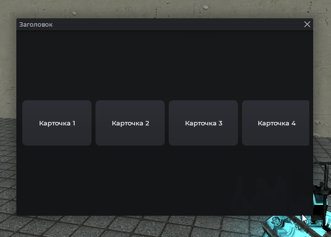

# MantleHScroll

A panel with horizontal scrolling. Content is laid out from left to right and clipped at the right edge. Suited for strips of cards and icons.

## Example



```js
local frame = vgui.Create('MantleFrame')
frame:SetSize(600, 500)
frame:Center()
frame:MakePopup()

local hscroll = vgui.Create('MantleHScroll', frame)
hscroll:Dock(FILL)
hscroll:DockMargin(0, 130, 0, 130)

for i = 1, 10 do
    local btn = vgui.Create('MantleBtn', hscroll)
    btn:Dock(LEFT)
    btn:SetWide(140)
    btn:DockMargin(4, 4, 4, 4)
    btn:SetTxt('Card ' .. i)
end
```

## Controlling the position

```js
local frame = vgui.Create('MantleFrame')
frame:SetSize(600, 500)
frame:Center()
frame:MakePopup()

local hscroll = vgui.Create('MantleHScroll', frame)
hscroll:Dock(FILL)

-- Scroll to the start
hscroll:SetScroll(0)

-- Current position
print(hscroll:GetScroll())
```

## Methods

| Method                                   | Description                            |
| ---------------------------------------- | -------------------------------------- |
| `:GetCanvas()`                           | Get the content container panel        |
| `:AddItem(panel)`                        | Append a panel to the end of the strip |
| `:SetScroll(number value)`               | Set the horizontal position            |
| `:GetScroll()`                           | Current position                       |
| `:Clear()`                               | Remove all content                     |
| `:DockPadding(left, top, right, bottom)` | Inner padding                          |

## Notes

- There is no scrollbar: the strip is scrolled with the mouse wheel or by dragging.
