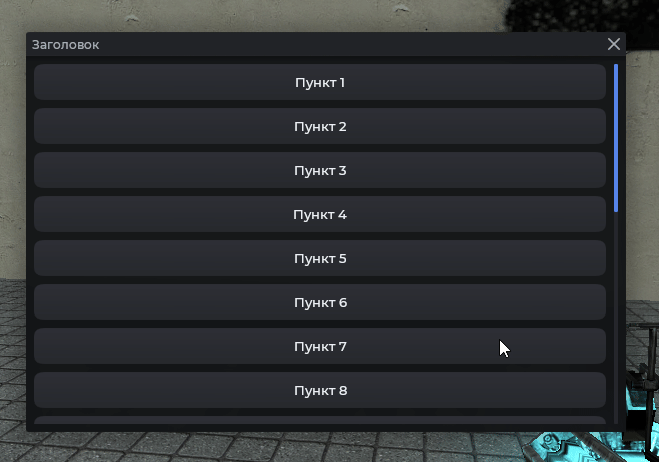
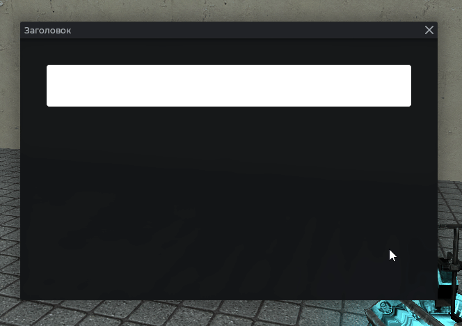
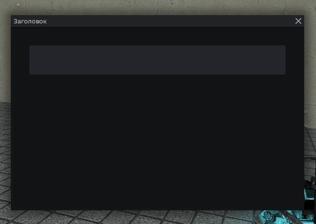

# MantleScrollPanel

A panel with vertical scrolling. It supports mouse wheel scrolling and dragging the content with the mouse. Content is laid out with `:Dock(TOP)` and stretches to the full width automatically.

## Example



```js
local frame = vgui.Create('MantleFrame')
frame:SetSize(600, 500)
frame:Center()
frame:MakePopup()

local scroll = vgui.Create('MantleScrollPanel', frame)
scroll:Dock(FILL)

for i = 1, 20 do
    local btn = vgui.Create('MantleBtn', scroll:GetCanvas())
    btn:Dock(TOP)
    btn:SetTall(36)
    btn:DockMargin(0, 0, 0, 8)
    btn:SetTxt('Item ' .. i)
end
```

## Controlling scrolling from code

```js
local frame = vgui.Create('MantleFrame')
frame:SetSize(600, 500)
frame:Center()
frame:MakePopup()

local scroll = vgui.Create('MantleScrollPanel', frame)
scroll:Dock(FILL)

for i = 1, 20 do
    local btn = vgui.Create('MantleBtn', scroll:GetCanvas())
    btn:Dock(TOP)
    btn:SetTall(36)
    btn:DockMargin(0, 0, 0, 8)
    btn:SetTxt('Item ' .. i)
end

-- Scroll down
scroll:SetScroll(500)

timer.Simple(2, function()
    -- Back to the top
    scroll:SetScroll(0)
end)

-- Read the current position
print(scroll:GetScroll())
```

## Clearing the content

```js
local frame = vgui.Create('MantleFrame')
frame:SetSize(600, 500)
frame:Center()
frame:MakePopup()

local scroll = vgui.Create('MantleScrollPanel', frame)
scroll:Dock(FILL)

scroll:Clear()
```

This removes every panel from the canvas.

## Content padding



```js
local frame = vgui.Create('MantleFrame')
frame:SetSize(600, 500)
frame:Center()
frame:MakePopup()

local scroll = vgui.Create('MantleScrollPanel', frame)
scroll:Dock(FILL)
scroll:DockPadding(30, 30, 30, 30)

local pan = vgui.Create('DPanel', scroll:GetCanvas())
pan:Dock(TOP)
pan:SetTall(60)
pan.Paint = function(_, w, h)
    draw.RoundedBox(6, 0, 0, w, h, color_white)
end
```

## Scrollbar setup

Lets you enable or disable the gap between the scrollbar and the content.

```js
local frame = vgui.Create('MantleFrame')
frame:SetSize(600, 500)
frame:Center()
frame:MakePopup()

local scroll = vgui.Create('MantleScrollPanel', frame)
scroll:Dock(FILL)

-- Disable it
scroll:DisableVBarPadding()

-- Adjust it manually
scroll:SetVBarPaddingRight(true)

-- The scrollbar panel itself
local vbar = scroll:GetVBar()
vbar:SetVisible(false)
```

## Methods

| Method                                   | Description                                                     |
| ---------------------------------------- | --------------------------------------------------------------- |
| `:GetCanvas()`                           | Get the content container panel. Add elements to it             |
| `:GetVBar()`                             | The scrollbar panel                                             |
| `:AddItem(panel)`                        | Add a panel                                                     |
| `:SetScroll(number value)`               | Set the vertical scroll position                                |
| `:GetScroll()`                           | Current scroll position                                         |
| `:Clear()`                               | Remove all content                                              |
| `:DockPadding(left, top, right, bottom)` | Inner padding                                                   |
| `:DisableVBarPadding()`                  | Remove the gap reserved for the scrollbar                       |
| `:SetVBarPaddingRight(bool enabled)`     | Enable or disable the right-side gap for the scrollbar          |

## Notes

- The scrollbar only appears when the content overflows.
- You can scroll by holding the left mouse button and dragging.


