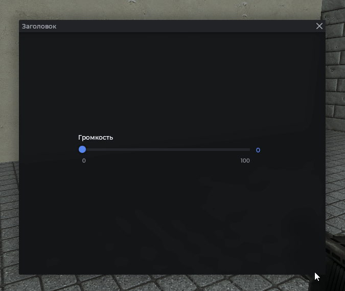
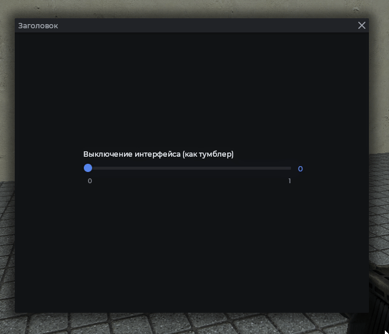

# MantleSlideBox

A slider. It supports value ranges, decimals, and ConVar binding.

## Example



```js
local frame = vgui.Create('MantleFrame')
frame:SetSize(600, 500)
frame:Center()
frame:MakePopup()

local slider = vgui.Create('MantleSlideBox', frame)
slider:SetWide(400)
slider:Center()
slider:SetRange(0, 100, 0)
slider:SetText('Volume')
```

## Reading and setting the value

```js
local frame = vgui.Create('MantleFrame')
frame:SetSize(600, 500)
frame:Center()
frame:MakePopup()

local slider = vgui.Create('MantleSlideBox', frame)
slider:SetWide(400)
slider:Center()
slider:SetRange(0, 100, 0)
slider:SetText('Volume')

slider:SetValue(50)
print(slider:GetValue()) -- 50
```

## Handling changes

Override `:OnValueChanged`. It fires on every movement of the slider.

```js
local frame = vgui.Create('MantleFrame')
frame:SetSize(600, 500)
frame:Center()
frame:MakePopup()

local slider = vgui.Create('MantleSlideBox', frame)
slider:SetWide(400)
slider:Center()
slider:SetRange(0, 1, 2)
slider:SetText('Opacity')

slider.OnValueChanged = function(self, value)
    print('Opacity:', value)
end
```

## Binding to a ConVar

The value stays in sync with the ConVar, and moving the slider writes it back.



```js
local frame = vgui.Create('MantleFrame')
frame:SetSize(600, 500)
frame:Center()
frame:MakePopup()

local slider = vgui.Create('MantleSlideBox', frame)
slider:SetWide(400)
slider:Center()
slider:SetRange(0, 1)
slider:SetText('HUD off (acts like a toggle)')
slider:SetConvar('cl_drawhud')
```

`SetRange(min, max, decimals)` - the third argument sets the number of decimal places.

## Methods

| Method                                      | Description                                                      |
| ------------------------------------------- | ---------------------------------------------------------------- |
| `:SetRange(int min, int max, int decimals)` | Range and decimal places. Default `0..1`, `0` decimals           |
| `:SetConvar(string convar)`                 | Bind to a ConVar                                                 |
| `:SetText(string text)`                     | Label on the left                                                |
| `:SetValue(number value)`                   | Set the value                                                    |
| `:GetValue()`                               | Current value                                                    |
| `:GetFraction()`                            | Slider position from `0` to `1`                                  |
| `:SetDecimals(int decimals)`                | Decimal places (`0..6`)                                          |
| `:OnValueChanged(panel self, number value)` | Called when the value changes                                    |
