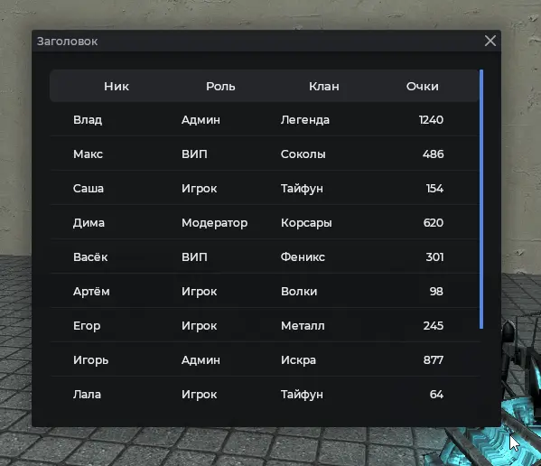
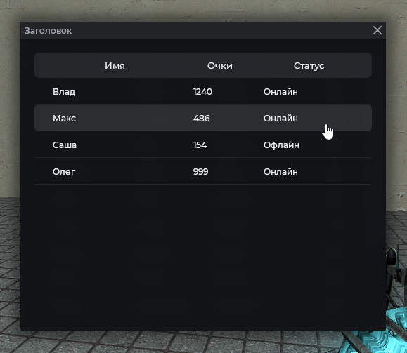

# MantleTable

A table with columns, row selection, and sorting. Rows scroll while the header stays in place.

## Example



```js
local frame = vgui.Create('MantleFrame')
frame:SetSize(520, 440)
frame:Center()
frame:MakePopup()

local tbl = vgui.Create('MantleTable', frame)
tbl:Dock(FILL)
tbl:DockMargin(12, 12, 12, 12)

local cols = {
    { 'Nick', 120, TEXT_ALIGN_LEFT, true },
    { 'Role', 110, TEXT_ALIGN_LEFT, true },
    { 'Clan', 120, TEXT_ALIGN_LEFT, true },
    { 'Score', 90, TEXT_ALIGN_RIGHT, true },
}

for _, col in ipairs(cols) do
    tbl:AddColumn(col[1], col[2], col[3], col[4])
end

local data = {
    { 'Vlad', 'Admin', 'Legend', 1240 },
    { 'Max', 'VIP', 'Falcons', 486 },
    { 'Sasha', 'Player', 'Typhoon', 154 },
    { 'Dima', 'Moderator', 'Corsairs', 620 },
    { 'Vasya', 'VIP', 'Phoenix', 301 },
    { 'Artyom', 'Player', 'Wolves', 98 },
    { 'Egor', 'Player', 'Metal', 245 },
    { 'Igor', 'Admin', 'Spark', 877 },
    { 'Lala', 'Player', 'Typhoon', 64 },
    { 'Pasha', 'Moderator', 'Falcons', 512 },
    { 'Oleg', 'VIP', 'Corsairs', 999 },
    { 'Mangal', 'Player', 'Wolves', 187 },
}

for i = 1, #data do
    tbl:AddItem(unpack(data[i]))
end
```

## Sorting by a column

Sorting is enabled by clicking the header. To allow it, mark the column as sortable.

```js
local frame = vgui.Create('MantleFrame')
frame:SetSize(520, 440)
frame:Center()
frame:MakePopup()

local tbl = vgui.Create('MantleTable', frame)
tbl:Dock(FILL)
tbl:DockMargin(12, 12, 12, 12)

tbl:AddColumn('Nick', 200, nil, true) -- when false, the column is not sortable
tbl:AddColumn('Score', 100, nil, true) -- false by default

tbl:AddItem('darkf', 42)
tbl:AddItem('john', 5)
tbl:AddItem('sasha', 150)
tbl:AddItem('max', 87)
tbl:AddItem('dima', 33)
```

## Column alignment



```js
local frame = vgui.Create('MantleFrame')
frame:SetSize(520, 440)
frame:Center()
frame:MakePopup()

local tbl = vgui.Create('MantleTable', frame)
tbl:Dock(FILL)
tbl:DockMargin(12, 12, 12, 12)

-- Alignment: 'left', 'center', 'right'
tbl:AddColumn('Name', 200, 'left')
tbl:AddColumn('Score', 100, 'center', true)
tbl:AddColumn('Status', 80, 'right')

tbl:AddItem('Vlad', 1240, 'Online')
tbl:AddItem('Max', 486, 'Online')
tbl:AddItem('Sasha', 154, 'Offline')
tbl:AddItem('Oleg', 999, 'Online')
```

## Row actions

```js

local frame = vgui.Create('MantleFrame')
frame:SetSize(520, 440)
frame:Center()
frame:MakePopup()

local tbl = vgui.Create('MantleTable', frame)
tbl:Dock(FILL)
tbl:DockMargin(12, 12, 12, 12)

tbl:AddColumn('Nick', 160)
tbl:AddColumn('Role', 140)
tbl:AddColumn('Score', 90)

tbl:AddItem('darkf', 'Admin', 42)
tbl:AddItem('john', 'Player', 5)
tbl:AddItem('sasha', 'VIP', 150)
tbl:AddItem('max', 'Moderator', 87)
tbl:AddItem('dima', 'Player', 33)

-- Left click on a row
tbl:SetAction(function(row, index)
    print('Row clicked', index)
    PrintTable(row)
end)

-- Right click on a row
tbl:SetRightClickAction(function(row, index)
    print('Row right-clicked', index)
    PrintTable(row)
end)
```

## Removing a row

```js
local frame = vgui.Create('MantleFrame')
frame:SetSize(520, 440)
frame:Center()
frame:MakePopup()

local tbl = vgui.Create('MantleTable', frame)
tbl:Dock(FILL)
tbl:DockMargin(12, 12, 12, 12)

tbl:AddColumn('Nick', 300)

tbl:AddItem('darkf')
tbl:AddItem('john')
tbl:AddItem('sasha')
tbl:AddItem('max')

-- Remove the first row (indexing starts at 1)
tbl:RemoveRow(1)

print(tbl:GetRowCount()) -- 3
```

## Methods

| Method                                                                    | Description                                                         |
| ------------------------------------------------------------------------- | ------------------------------------------------------------------- |
| `:AddColumn(string name, int width, string\|number align, bool sortable)` | Column. `align`: `'left'`, `'center'`, `'right'`, or `TEXT_ALIGN_*` |
| `:AddItem(...)`                                                           | Add a row. Returns the row number                                   |
| `:SortByColumn(int columnIndex, bool descending)`                         | Sort by a column. `descending` flips the direction (optional)       |
| `:SetAction(function func)`                                               | Left click action: `func(row, index)`                               |
| `:SetRightClickAction(function func)`                                     | Right click action: `func(row, index)`                              |
| `:SetContextMenuEnabled(bool enabled)`                                    | Show the built-in context menu. Default `true`                      |
| `:Clear()`                                                                | Clear the table                                                     |
| `:ClearSelection()`                                                       | Clear the selection                                                 |
| `:GetSelectedRow()`                                                       | Data of the selected row, or `nil`                                  |
| `:SetSelectedRow(int index)`                                              | Select a row by index. `nil` clears the selection                   |
| `:GetRowCount()`                                                          | Number of rows                                                      |
| `:GetColumnCount()`                                                       | Number of columns                                                   |
| `:GetRow(int index)`                                                      | Row data, or `nil`                                                  |
| `:GetRowIndex(table rowData)`                                             | Row index from its data                                             |
| `:RemoveRow(int index)`                                                   | Remove a row by index                                               |
| `:RemoveItem(table rowData)`                                              | Remove a row by its data                                            |
| `:SetCellValue(int rowIndex, int columnIndex, any value)`                 | Write a cell value                                                  |
| `:GetCellValue(int rowIndex, int columnIndex)`                            | Read a cell value                                                   |
| `:SetFont(string font)`                                                   | Header font. Default `Fated.18`                                     |
| `:SetRowFont(string font)`                                                | Row font. Default `Fated.16`                                        |
| `:SetHeaderHeight(int height)`                                            | Header height. Default `36`                                         |
| `:SetRowHeight(int height)`                                               | Row height. Default `38`                                            |
| `:SetPadding(int padding)`                                                | Text padding inside a cell. Default `12`                            |
| `:SetSidePadding(int padding)`                                            | Side padding of the table. Default `14`                             |

## Notes

- Right-clicking a row shows a menu with "Copy value" and "Remove row".
- Clicking a sortable column again flips the sort direction.
