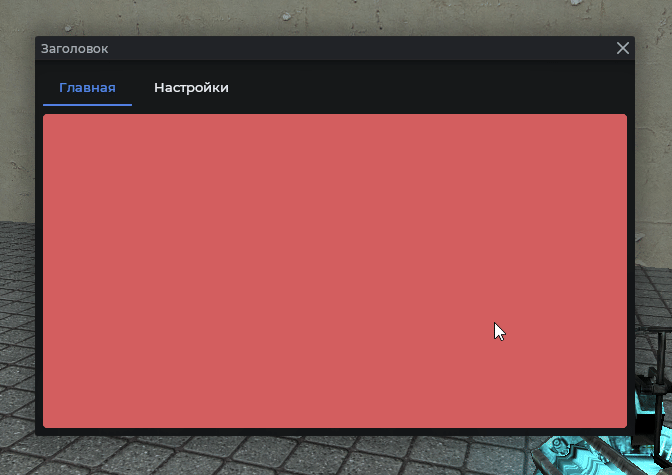
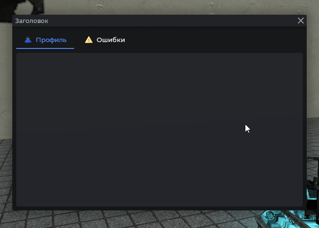
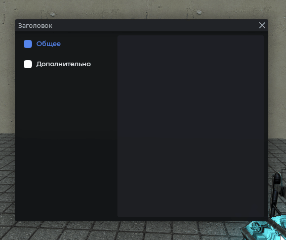
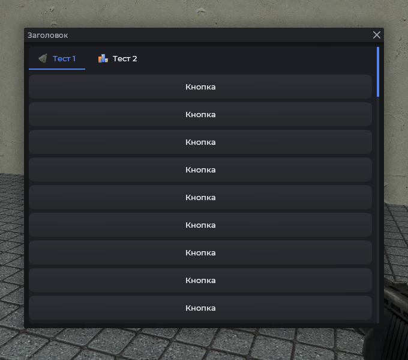
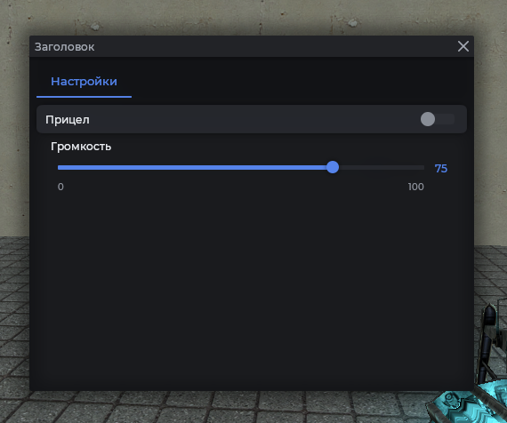

# MantleTabs

Tabs that switch content. Two styles are available: `modern` (tabs on top) and `classic` (list on the left).

## Example



```js
local frame = vgui.Create('MantleFrame')
frame:SetSize(600, 500)
frame:Center()
frame:MakePopup()

local tabs = vgui.Create('MantleTabs', frame)
tabs:Dock(FILL)

local page1 = vgui.Create('Panel', tabs)
page1.Paint = function(_, w, h)
    draw.RoundedBox(6, 0, 0, w, h, Color(210, 95, 95))
end
tabs:AddTab('Home', page1)

local page2 = vgui.Create('Panel', tabs)
page2.Paint = function(_, w, h)
    draw.RoundedBox(6, 0, 0, w, h, Color(95, 210, 95))
end
tabs:AddTab('Settings', page2)
```

## Switching from code

```js
local frame = vgui.Create('MantleFrame')
frame:SetSize(600, 500)
frame:Center()
frame:MakePopup()

local tabs = vgui.Create('MantleTabs', frame)
tabs:Dock(FILL)

local page1 = vgui.Create('Panel', tabs)
page1.Paint = function(_, w, h)
    draw.RoundedBox(6, 0, 0, w, h, Color(210, 95, 95))
end
tabs:AddTab('Home', page1)

local page2 = vgui.Create('Panel', tabs)
page2.Paint = function(_, w, h)
    draw.RoundedBox(6, 0, 0, w, h, Color(95, 210, 95))
end
tabs:AddTab('Settings', page2)

-- Activate the second tab (indexing starts at 1)
tabs:SetActiveTab(2)
```

## Tabs with icons



```js
local frame = vgui.Create('MantleFrame')
frame:SetSize(600, 500)
frame:Center()
frame:MakePopup()

local tabs = vgui.Create('MantleTabs', frame)
tabs:Dock(FILL)

local page1 = vgui.Create('Panel', tabs)
page1.Paint = function(_, w, h)
    draw.RoundedBox(6, 0, 0, w, h, Mantle.color.panel_alpha[1])
end
tabs:AddTab({ title = 'Profile', icon = Material('icon16/user.png') }, page1)

local page2 = vgui.Create('Panel', tabs)
page2.Paint = function(_, w, h)
    draw.RoundedBox(6, 0, 0, w, h, Mantle.color.panel_alpha[1])
end
tabs:AddTab({ title = 'Errors', icon = Material('icon16/error.png') }, page2)
```

## Classic style

The list of tabs sits on the left.



```js
local frame = vgui.Create('MantleFrame')
frame:SetSize(600, 500)
frame:Center()
frame:MakePopup()

local tabs = vgui.Create('MantleTabs', frame)
tabs:Dock(FILL)
tabs:SetTabStyle('classic')

local page1 = vgui.Create('DPanel', tabs)
page1.Paint = function(_, w, h)
    draw.RoundedBox(6, 0, 0, w, h, Mantle.color.panel_alpha[2])
end
tabs:AddTab('General', page1)

local page2 = vgui.Create('DPanel', tabs)
page2.Paint = function(_, w, h)
    draw.RoundedBox(6, 0, 0, w, h, Mantle.color.panel_alpha[3])
end
tabs:AddTab('Advanced', page2)
```

## Tabs with scrolling

A gradual top shadow and blur create a smooth transition effect.



```js
local frame = vgui.Create('MantleFrame')
frame:SetSize(600, 500)
frame:Center()
frame:MakePopup()

local tabs = vgui.Create('MantleTabs', frame)
tabs:Dock(FILL)

local function createElements(parent)
    for k = 1, 50 do
        local btn = vgui.Create('MantleBtn', parent)
        btn:Dock(TOP)
        btn:DockMargin(0, 0, 0, 6)
        btn:SetTall(40)
    end
end

local page1 = vgui.Create('MantleScrollPanel', tabs)
page1.Paint = function(_, w, h)
    draw.RoundedBox(6, 0, 0, w, h, Mantle.color.panel_alpha[2])
end
createElements(page1)
tabs:AddTab({ title = 'Test 1', icon = Material('icon16/bell.png') }, page1)

local page2 = vgui.Create('MantleScrollPanel', tabs)
page2.Paint = function(_, w, h)
    draw.RoundedBox(6, 0, 0, w, h, Mantle.color.panel_alpha[2])
end
createElements(page2)
tabs:AddTab({ title = 'Test 2', icon = Material('icon16/chart_bar.png') }, page2)
```

## Pages with elements



```js
local frame = vgui.Create('MantleFrame')
frame:SetSize(600, 500)
frame:Center()
frame:MakePopup()

local tabs = vgui.Create('MantleTabs', frame)
tabs:Dock(FILL)

local settings = vgui.Create('Panel', tabs)
local cb = vgui.Create('MantleCheckBox', settings)
cb:Dock(TOP)
cb:SetTxt('Crosshair')

local slider = vgui.Create('MantleSlideBox', settings)
slider:Dock(TOP)
slider:SetRange(0, 100, 0)
slider:SetText('Volume')

tabs:AddTab('Settings', settings)
```

## Methods

| Method                                        | Description                                                             |
| --------------------------------------------- | ----------------------------------------------------------------------- |
| `:AddTab(string\|table tab, pan panel, icon)` | Add a tab. `tab` can be a string or `{ title, description, icon, pan }` |
| `:SetActiveTab(int\|string id, bool silent)`  | Switch to a tab by index or title. `silent` disables the click sound    |
| `:GetActiveTab()`                             | Index of the active tab                                                 |
| `:GetTabCount()`                              | Number of tabs                                                          |
| `:SetTabStyle(string style)`                  | Style: `modern` or `classic`. Default `modern`                          |
| `:SetTabHeight(int height)`                   | Height of the tab area (`36..72`). Default `44`                         |
| `:SetIndicatorHeight(int height)`             | Thickness of the active tab indicator (`1..3`). Default `1`             |
| `:SetClassicTabWidth(int width)`              | Width of a tab in the `classic` style (`128..240`). Default `200`       |

### Tab table fields

When you pass a table to `AddTab`, these fields are available:

| Field         | Type       | Description             |
| ------------- | ---------- | ----------------------- |
| `title`       | `string`   | Tab title               |
| `name`        | `string`   | Alternative to `title`  |
| `description` | `string`   | Caption under the title |
| `icon`        | `material` | Tab icon                |
| `pan`         | `panel`    | Content panel           |
| `panel`       | `panel`    | Alternative to `pan`    |
