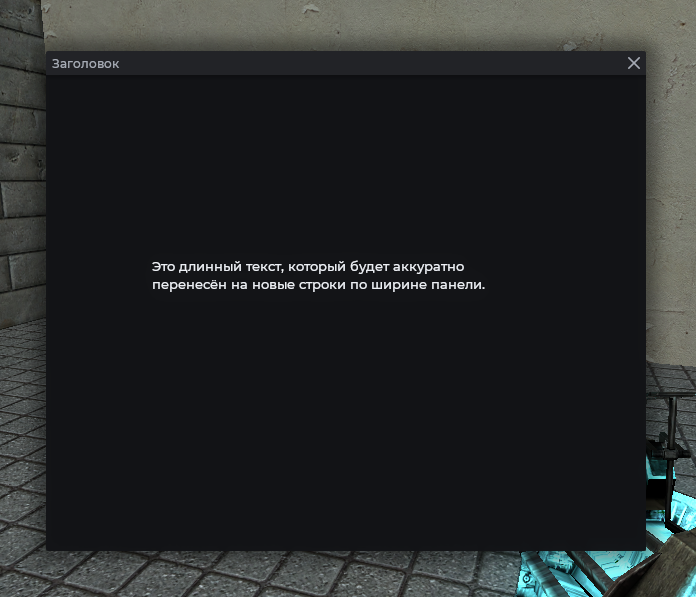
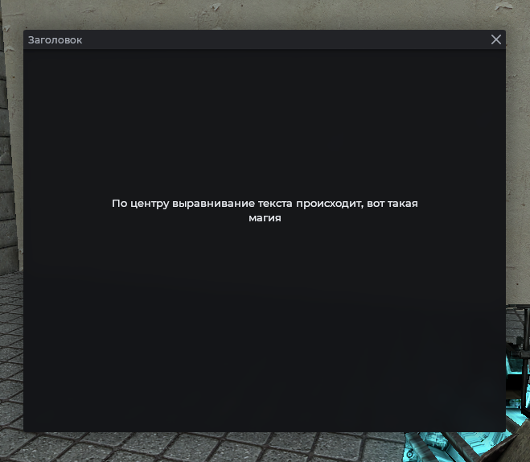

# MantleText

Multi-line text that wraps by words and adds an ellipsis when it overflows. Cyrillic is supported.

## Example



```js
local frame = vgui.Create('MantleFrame')
frame:SetSize(600, 500)
frame:Center()
frame:MakePopup()

local text = vgui.Create('MantleText', frame)
text:SetSize(400, 100)
text:Center()
text:SetText('This is a long piece of text that will be neatly wrapped onto new lines according to the panel width.')
```

## Font and color

```js
local frame = vgui.Create('MantleFrame')
frame:SetSize(600, 500)
frame:Center()
frame:MakePopup()

local text = vgui.Create('MantleText', frame)
text:SetSize(400, 100)
text:Center()
text:SetText('Section title')
text:SetFont('Fated.22b')
text:SetColor(Mantle.color.text)
```

## Alignment

`SetAlign` handles horizontal alignment, `SetVAlign` vertical alignment.



```js
local frame = vgui.Create('MantleFrame')
frame:SetSize(600, 500)
frame:Center()
frame:MakePopup()

local text = vgui.Create('MantleText', frame)
text:SetSize(400, 100)
text:Center()
text:SetText('Centered text alignment works like this, such magic')
text:SetAlign(TEXT_ALIGN_CENTER)
text:SetVAlign(TEXT_ALIGN_CENTER)
```

## Inner padding

```js
local frame = vgui.Create('MantleFrame')
frame:SetSize(600, 500)
frame:Center()
frame:MakePopup()

local text = vgui.Create('MantleText', frame)
text:SetSize(400, 100)
text:Center()
text:SetText('Text with padding')
text:SetPadding(12)
```

## Methods

| Method                              | Description                                                                                                            |
| ----------------------------------- | ---------------------------------------------------------------------------------------------------------------------- |
| `:SetText(string text)`             | Set the text                                                                                                           |
| `:GetText()`                        | Current text                                                                                                           |
| `:SetFont(string font)`             | Font. Default `Fated.16`                                                                                               |
| `:SetColor(color color)`            | Text color                                                                                                             |
| `:SetAlign(number align)`           | Horizontal alignment                                                                                                   |
| `:SetVAlign(string\|number valign)` | Vertical alignment: `'top'`/`'center'`/`'bottom'` or `TEXT_ALIGN_TOP`/`TEXT_ALIGN_CENTER`/`TEXT_ALIGN_BOTTOM`          |
| `:SetPadding(int padding)`          | Inner padding. Default `6`                                                                                             |
| `:InvalidateTextLayout()`           | Recalculate the text layout (useful after changing the font or width)                                                  |

## Notes

- Cyrillic is supported via UTF-8.
